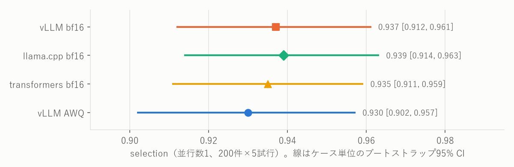

# toolcall-serving-bench ― 同じ8Bモデルを3つの推論エンジンで測り、ツール呼び出しの精度とレイテンシから構成を選ぶ

同じモデル（Qwen3-8B）を3つの推論エンジン（vLLM・llama.cpp・transformers）に載せ、同じGPU（NVIDIA L4 1台）で、
**ツール呼び出し（function calling）の精度とレイテンシが、エンジン・量子化・並行数でどう変わるか**を測った。
そのうえで、精度の足切りとレイテンシの基準から、目標の並行数ごとに必要なGPUの台数が最も少ない構成を選んだ。
評価セットは、汎用ERPのツール群に対する日本語の200件を自作した。

> エンジンの速さの順位表を作るプロジェクトではない。L4 1台・このワークロードという条件の下で、
> **判定の規則を結果より先に決めて記録し、その規則どおりに構成を選ぶ**までの手順を示すことが目的。

---

## 結果サマリー

| 項目 | 値 |
| --- | --- |
| モデル | Qwen3-8B（bf16、AWQ 4bit、GGUF Q4_K_M） |
| エンジン | vLLM 0.31.0・llama.cpp `848bbda`・transformers 5.17.0 |
| ハードウェア | `g6.xlarge`（NVIDIA L4 24GB）1台、ap-northeast-1 |
| 評価セット | 日本語200件（うちツールを呼ぶべきでない30件）。40個のツールから10個を提示 |
| bf16の精度（並行数1） | selection 0.935〜0.939。エンジン間の差は見分けられない |
| 4bitの非劣化（許す差 −2.6pt） | **vLLM AWQ：示せた**（下限 −2.48pt）／llama.cpp Q4_K_M：示せなかった（下限 −4.05pt） |
| 会話用の基準を満たす最大の並行数 | **vLLM AWQ 4**、vLLM bf16 2、llama.cpp・transformers 1 |
| 選定 | **目標の並行数が4以上なら vLLM AWQ が最少の台数**（並行数16で4台、vLLM bf16は8台）。2以下では差がつかない |
| 負荷の下の精度 | 並行数1と16で答えが変わらない（等価）とは、どの構成も示せなかった |
| GPUでの実行 | apply 7回、計約$47 |

用語：**並行数**は同時に送るリクエストの数。**selection**は正しいツールを選べた割合（呼ぶべきでない場面で呼ばないことを含む）。
**会話用の基準**はMLPerf InferenceのLlama 3.1 8B向けの基準（TTFT 2,000ms・TPOT 100ms）で、超過したリクエストが1%以下なら「満たす」。

---

## 4bitで精度を保てたと言えるのは vLLM AWQ だけだった

各エンジンの中で、4bitとbf16のselectionを比べた（並行数1、greedy、200件×5試行）。許す差は −2.6pt で、Qwen3-8Bと4BのBFCLの差、
つまりモデル1段階分にあたる（[ADR-0002](docs/adr/0002-equivalence-margin.md)）。片側99.5%のt区間の下限がこれを上回れば「非劣化を示せた」とする（[ADR-0008](docs/adr/0008-quantization-noninferiority.md)）。


| 構成 | selection（bf16 → 4bit） | 差 | 片側99.5%の下限 | 判定 |
| --- | --- | --- | --- | --- |
| vLLM AWQ | 0.934 → 0.928 | −0.6pt | −2.48pt | **非劣化を示せた** |
| llama.cpp Q4_K_M | 0.935 → 0.915 | −2.0pt | −4.05pt | 示せなかった |

llama.cpp Q4_K_Mは、この後の選定から外した。

---

## 会話用の基準を満たす並行数は、vLLM AWQ が4で最も大きい

並行数1から倍々に上げ、各1,000件で会話用の基準を判定した（Clopper-Pearsonの片側95%限界で3値。[ADR-0003](docs/adr/0003-latency-pass-verdict.md)）。
並行数1から「満たす」が続く範囲の最大を、その構成の最大の並行数とした。


判定は超過件数で行う（この結果では、TTFTとTPOTのp99がどちらも基準線より下にある点と一致する）。白抜きの点が「満たさない」。図に無い点は、対応していない構成（「[詳しい値](#詳しい値)」）。

| 構成 | 最大の並行数 | 次の並行数での超過 |
| --- | --- | --- |
| vLLM AWQ | **4** | 並行数8で802/1,000 |
| vLLM bf16 | 2 | 並行数4で625/1,000 |
| llama.cpp bf16 | 1 | 並行数2で187/1,000 |
| transformers bf16 | 1 | 並行数2以上は測っていない |
| llama.cpp Q4_K_M（精度で外れた） | 1 | 並行数2で27/1,000 |

より厳しいinteractiveの基準（TTFT 500ms・TPOT 30ms）は、どの構成も並行数1で満たさなかった。セルごとのTTFT・TPOTは「[詳しい値](#詳しい値)」にある。

---

## 目標の並行数が4以上なら、vLLM AWQ が最も少ない台数で済む

目標の並行数を、最大の並行数で割って切り上げた台数（読み方は結果を見る前に[ADR-0008](docs/adr/0008-quantization-noninferiority.md)の追記で決めた）。

| 目標の並行数 | 1 | 2 | 4 | 8 | 16 | 32 |
| --- | --- | --- | --- | --- | --- | --- |
| vLLM AWQ | 1 | 1 | **1** | **2** | **4** | **8** |
| vLLM bf16 | 1 | 1 | 2 | 4 | 8 | 16 |
| llama.cpp bf16・transformers bf16 | 1 | 2 | 4 | 8 | 16 | 32 |
| 最少の構成 | 4構成が同じ | vLLMの2構成が同じ | vLLM AWQ | vLLM AWQ | vLLM AWQ | vLLM AWQ |

vLLM AWQは、精度でもbf16より2.6pt以上悪くはないと示せている。ただし並行数4の判定はインスタンスによって変わった（「[限界と範囲外](#限界と範囲外)」の1つ目）。

---

## 並行数16で、greedyの答えが変わらないとは言えなかった

同じ構成で並行数1と16の答え（greedy）を比べ、selectionの正誤が入れ替わったケースを数えた（ADRでは「第3パス」）。
入れ替わった割合の片側97.5%上限（Clopper-Pearson）が2.6%未満なら「等価」とする（[ADR-0002](docs/adr/0002-equivalence-margin.md)の追記2026-10-22・2026-10-26）。

| 構成 | 入れ替わり（1,000組中） | selectionの差 | 片側97.5%上限 | 判定 |
| --- | --- | --- | --- | --- |
| vLLM AWQ | 2 | +0.2pt | 3.57% | 等価とは示せなかった |
| llama.cpp bf16 | 1 | −0.1pt | 2.75% | 等価とは示せなかった |
| vLLM bf16 | — | — | — | 並行数16に対応できなかった |

入れ替わりはどちらも数件で、差もほぼ0だが、1,000組では2.6%未満と言い切るだけの件数が無かった。「変わる」と示したわけではない。

---

## 方法

### 比べるもの

| 層 | エンジン | チェックポイント | 量子化 |
| --- | --- | --- | --- |
| 1：エンジンの比較 | `transformers_hf` | `Qwen/Qwen3-8B` | bf16 |
| 1：エンジンの比較 | `llama_cpp` | `Qwen/Qwen3-8B`から自前で変換したGGUF | bf16（GGUFへの詰め替えのみ） |
| 1：エンジンの比較 | `vllm` | `Qwen/Qwen3-8B` | bf16 |
| 2：量子化 | `vllm` | `Qwen/Qwen3-8B-AWQ`（公式） | AWQ 4bit |
| 2：量子化 | `llama_cpp` | 上のbf16 GGUFから、固定した版の`llama-quantize`で作ったもの | Q4_K_M |

- **層を2つに分ける理由**：Q4_K_MとAWQは別のアルゴリズムなので、4bit同士で比べると、差がエンジンのせいか量子化のせいか区別できない。
  エンジンの比較はbf16にそろえ、量子化は各エンジンの中でbf16との非劣化として確かめる（[ADR-0008](docs/adr/0008-quantization-noninferiority.md)）。
- **同じハードウェア**：全エンジンを同じ`g6.xlarge`で動かす。インスタンスはTerraformで立て、測り終えたら`destroy`する。
- **エンジン以外の条件をそろえる仕組み**
  - どのセル（構成×並行数×パスの1単位）も、エンジンのサーバーを起動し直してから回す（llama.cppにはプロンプトのキャッシュを全部消すAPIが無いため）
  - 並行数2以上では、回す前にKVキャッシュに全リクエストが入るかを全エンジン共通の式で確かめ、回した後に中断や打ち切りが無かったかを確かめる
    （[ADR-0005](docs/adr/0005-capacity-check.md)）。入らない構成は「対応していない」と記録し、設定を上げて載せることはしない
  - 実行ごとにrun manifest（エンジンの版、起動コマンド、ハードウェア、サンプリング設定、容量の判定）を残し、schemaで検証する。
    生出力はmanifestより先に書くので、インスタンスを消した後でも採点し直せる

### 判定のしかた

判定の規則と数値は、結果を見る前にADRで決めた。結果を見た後に決めたこと（台数の表に本番1回目の値を使う、安定判定の窓の切り方を直す、など）は、そのことを明記してADRの追記に残している。

| 測るもの | 条件 | 判定 |
| --- | --- | --- |
| 精度 | 並行数1、提示順を変えて200件×5試行 | 判定はしない。構成ごとの値を、ケース単位のブートストラップCIつきで報告する |
| 量子化の非劣化 | 並行数1、greedy、200件×5試行で、4bitとbf16のselectionの差 | 片側99.5%のt区間の下限が −2.6pt を上回れば「非劣化を示せた」（[ADR-0008](docs/adr/0008-quantization-noninferiority.md)） |
| レイテンシ | TTFTとTPOT。並行数1/2/4/8…と倍々に、満たさなくなるか対応できなくなるまで（上限32） | 会話用の基準を、超過率1%以下で満たすかの3値（満たす／満たさない／判定不能）（[ADR-0003](docs/adr/0003-latency-pass-verdict.md)） |
| 負荷の下の精度 | 並行数1と16で、greedyの答えが変わるか | 入れ替わりの割合の上限が2.6%未満なら「等価」（[ADR-0002](docs/adr/0002-equivalence-margin.md)） |
| 選定 | 上の結果から | 精度で足切り → 目標の並行数ごとに台数が最少の構成。同数なら両方を示す（[ADR-0008](docs/adr/0008-quantization-noninferiority.md)） |

精度とレイテンシは別々に実行する。精度を測る負荷がレイテンシを歪めないようにするためである。

---

## 限界と範囲外

- **インスタンスによる差**：vLLM AWQの並行数4は、本番1回目のインスタンスでは満たした（超過2/1,000）が、本番3回目の別のインスタンスでは
  満たさなかった（59/1,000。同じ電力の上限でSMクロックが約12%低い）。台数の表は、全構成を同じインスタンスで測った本番1回目の値を使っている
  （[ADR-0007](docs/adr/0007-main-run-layout.md)）。別のインスタンスではvLLM AWQの最大は2になり得て、そのときはどの目標でもvLLM bf16と同じ台数になる。
  vLLM bf16の並行数2（超過3/1,000）も境目に近く、どちらも測り直していない。
- **目標の並行数を先に決めなかった**ので、1つの答えではなく、目標ごとの台数の表で示した。
- **量子化**：非劣化は並行数1でだけ確かめた。4bitはQ4_K_MとAWQの2種類だけ。Q4_K_Mは公式のGGUFではなく、bf16のGGUFから自分で作った（チャットテンプレートをそろえるため）。
- **transformers**は並行数1だけを測った。素の`generate()`には複数のリクエストをまとめて処理する仕組み（スケジューラ・共有KV）が無いため。
- **条件の幅**：GPUはL4 1種類、モデルはQwen3-8Bだけ。ツールを1回呼ぶまで（単発）を測り、ツールの実行や複数ターンは扱わない。
- **Tool RAGの理想化**：クエリごとに10個のツールを渡す構成を想定しているが、正解のツールは必ず入れ、並び順はランダム、本物の検索は走らせていない。
  ツール定義がリクエストごとに変わるので、prefix cacheはほぼ効かない（実測2〜9%）。ツール一式を固定してキャッシュが効く構成は範囲外。
- **評価セット**：ツールは架空のERPの40個。200件のうち186件のクエリはLLMが書いた（正解はスクリプトが作り、人が全件を確認した）。

---

## 詳しい値

### 精度

並行数1、200件×5試行（本番2回目）。CIはケース単位のブートストラップ95%。CIはすべて重なっていて、構成の優劣は結論にしない。



| 構成 | selection（95% CI） | arg_exact |
| --- | --- | --- |
| vLLM bf16 | 0.937 [0.912, 0.961] | 0.985 |
| llama.cpp bf16 | 0.939 [0.914, 0.963] | 0.987 |
| transformers bf16 | 0.935 [0.911, 0.959] | 0.984 |
| vLLM AWQ | 0.930 [0.902, 0.957] | 0.981 |

### レイテンシ

各セル1,000件（ウォームアップを除く）。超過は、会話用の基準（TTFT 2,000ms・TPOT 100ms）のどちらかを超えたリクエストの数。
llama.cpp Q4_K_Mと最後の行は本番3回目、それ以外は本番1回目のインスタンスで測った。

| 構成 | 並行数 | TTFT p50 / p99（ms） | TPOT p50 / p99（ms） | 超過 | 判定 |
| --- | --- | --- | --- | --- | --- |
| vLLM AWQ | 1 | 682 / 783 | 22.4 / 22.6 | 0 | 満たす |
| | 2 | 717 / 1,372 | 38.6 / 53.3 | 0 | 満たす |
| | 4 | 736 / 1,466 | 70.2 / 97.9 | 2 | 満たす |
| | 8 | 817 / 2,619 | 126.0 / 185.1 | 802 | 満たさない |
| | 16 | 1,450 / 3,923 | 234.1 / 364.1 | 992 | 満たさない |
| | 32 | — | — | — | 対応していない（事前の判定） |
| vLLM bf16 | 1 | 749 / 838 | 61.4 / 61.5 | 0 | 満たす |
| | 2 | 825 / 1,344 | 78.8 / 88.2 | 3 | 満たす |
| | 4 | 849 / 1,503 | 105.4 / 130.4 | 625 | 満たさない |
| | 8 | 934 / 2,995 | 157.8 / 207.3 | 943 | 満たさない |
| | 16 | — | — | — | 対応していない（事前の判定） |
| llama.cpp bf16 | 1 | 1,209 / 1,333 | 60.9 / 61.2 | 0 | 満たす |
| | 2 | 1,390 / 2,455 | 92.8 / 131.5 | 187 | 満たさない |
| | 4 | 1,565 / 2,876 | 156.0 / 217.8 | 924 | 満たさない |
| | 8 | 1,696 / 5,597 | 283.6 / 406.3 | 986 | 満たさない |
| | 16 | 2,907 / 9,357 | 548.4 / 803.4 | 999 | 満たさない |
| | 32 | — | — | — | サーバーが起動しなかった |
| transformers bf16 | 1 | 808 / 904 | 69.4 / 69.8 | 0 | 満たす |
| llama.cpp Q4_K_M | 1 | 1,073 / 1,187 | 22.5 / 23.2 | 0 | 満たす |
| | 2 | 1,137 / 2,162 | 50.9 / 83.1 | 27 | 満たさない |
| | 4 | 1,215 / 2,370 | 109.3 / 157.6 | 769 | 満たさない |
| | 8 | 1,350 / 4,780 | 218.6 / 316.7 | 963 | 満たさない |
| | 16 | 2,345 / 7,440 | 425.0 / 613.7 | 999 | 満たさない |
| | 32 | 3,544 / 19,436 | 889.8 / 1,098.5 | 1,000 | 満たさない |
| vLLM AWQ（本番3回目） | 4 | 819 / 1,690 | 76.5 / 108.1 | 59 | 満たさない |

1件120秒の上限を超えたリクエストは超過として数えた：llama.cpp bf16の並行数8で5件・16で19件、Q4_K_Mの並行数16で4件・32で43件。

---

## 実行環境と費用

| 項目 | 値 |
| --- | --- |
| インスタンス | `g6.xlarge`（L4 24GB、4 vCPU）、ap-northeast-1、Deep Learning Base AMI（Ubuntu 22.04） |
| エンジンの版 | vLLM 0.31.0、llama.cpp `848bbda9041decd87904f7eb5a2990863ecce03b`、transformers 5.17.0、torch 2.13.0+cu132（[ADR-0006](docs/adr/0006-pin-engine-versions.md)で固定） |
| モデルのrevision | `Qwen/Qwen3-8B` `b968826`、`Qwen/Qwen3-8B-AWQ` `4da05a8` |
| GPUの電力 | 計測中の電力の中央値は全セルで70〜72W（L4の上限）。熱による低下は0回 |

GPUでの実行は7回のapplyに分けた（手順は[docs/gpu-runbook.md](docs/gpu-runbook.md)）。費用はCost Explorerの値で、本番3回目だけは単価からの見積もり。

| apply | 内容 | インスタンスの時間 | 費用 |
| --- | --- | --- | --- |
| 2026-10-18 | 疎通 | 2.0時間 | $2.4 |
| 2026-10-21 | 容量の疎通（途中で止めた） | 0.8時間 | $1.0 |
| 2026-10-22 | パイロット1 | 5.8時間 | $6.8 |
| 2026-10-24 | パイロット2 | 2.6時間 | $3.1 |
| 2026-10-24〜25 | 本番1回目：レイテンシ（18セル） | 12.7時間 | $15.1 |
| 2026-10-25 | 本番2回目：精度と負荷の下の精度（9セル） | 7.9時間 | $9.3 |
| 2026-10-26 | 本番3回目：量子化の非劣化とQ4_K_M（11セル） | 8.3時間 | 約$9.7 |
| 計 | | 約40時間 | 約$47 |

g6.xlargeは東京では1aと1cにしか無く、本番3回目は両方で約1.5時間 `InsufficientInstanceCapacity` が続いた。

---

## 評価セットと採点

### 分離採点

ツール呼び出しの能力を1つの成功率にまとめず、質の違う3つを別々に測る。

- **selection** — 正しいツールを選べるか（呼ぶべきでない場面で呼ばない、も含む）
- **arg_exact** — enum・数値・日付など、完全一致で判定すべき引数を埋められるか
- **arg_semantic** — 自由文の引数を、表記揺れを許して意味的に埋められるか

`e2e`（全部正解）は派生指標として足すだけで、一次指標にはしない。ツールの選択を外した事例では引数の指標をN/Aにし、
選択の失敗で引数を取り出す能力まで巻き添えにしない。

### ツールの数と紛らわしさ

ツール選択の正確さは、提示するツールの数と紛らわしさに強く左右される。3個から選ぶときの「選択95%」と、
似た機能のツールが並ぶ40個から選ぶときの「選択95%」は別物である。そこで次のように作っている。

- ツールは汎用ERPの標準モジュール（マスタ・販売・購買・在庫・会計・人事・帳票）の40個。各モジュールに、機能の近いツール
  （検索・明細取得・集計・推移・未処理一覧）を意図的に置く。拡張カタログ（`schema/tools_extended.json`）は100個まで。
- 提示するツールの数（`tool_stage`）は実験の変数にできる。正解のツール、事例が宣言した紛らわしいツール、同じモジュールの近いツール、
  ほかのモジュールのツールの順で埋め、固定シードで並べ替える。宣言した紛らわしいツールが入りきらない場合は、黙って落とさずエラーにする。
  エンジンの比較は`tool_stage=10`で行う。
- **想定する構成**：カタログを全部渡さず、クエリごとに10個に絞って渡す構成（Tool RAG）を想定する。
  40個を全部渡すとプロンプトは約8,000トークン（10個の約3.5倍）になり、紛らわしいツールが並ぶほど選択の精度も落ちるためである
  （[ADR-0003](docs/adr/0003-latency-pass-verdict.md)の追記2026-10-24）。
- 同じ事例で、提示するツールの構成は固定したまま並び順だけを変えて5試行する（`eval_bench/repetition.py`）。並び順の運を平均で消し、
  5回とも同じ答えだったかを**consistency**として数える。

### 200件の作り方

日本語のツール呼び出しの評価セットには、Nejumi LLMリーダーボードのBFCL日本語版があるが、英語の汎用APIを翻訳したもので、
単発のカテゴリは各30件しかない。日本語の業務領域で、提示するツールの数を変えて測れる評価セットは見当たらなかったので自作した。

1. 事例ごとに`provenance`（`seed_manual`／`grounded`／`adversarial_manual`／`generated`）を持ち、どの作り方の事例を除いても数値を計算し直せる。
2. `generated`（186件）は、**正解をスクリプトが規則と固定シードで作り**、LLMはクエリ文だけを書く。正解を見せない別のモデルの検査と、
   全件の人の確認を通している。人が直した件は`generation.human_edit`に残す（[ADR-0004](docs/adr/0004-expand-case-set.md)）。
3. `grounded`（4件）は、公開文書（有価証券報告書・自治体の例規集）の種類と年度を引数の正解にする（`source`必須）。LLMはクエリ文の言い換えだけを担う。
4. クエリの言い換えに使ったモデルは、評価の対象から外す。

内訳は200件（negative 30件）で、`generated` 186件・`seed_manual` 5件・`adversarial_manual` 5件・`grounded` 4件。
件数は、負荷の下の精度で±2.6ptの等価性を言うのに要る約140件を超えるように決めた。

---

## 動かし方

手元（GPU不要）：

```bash
pip install -r requirements.txt pytest
python -m pytest -q                                                    # PRごとにCIでも回る
python scripts/count_prompt_tokens.py --tool-stage 10 --write-budget   # ケースかカタログを変えたら数え直す
```

1セルの実行（エンジンのサーバーが`localhost:8000`で立っている前提）：

```bash
python scripts/run_cell.py --pass-type accuracy --engine vllm \
    --base-url http://localhost:8000 --model Qwen/Qwen3-8B --quantization bf16-none \
    --engine-version 0.31.0 --tool-stage 10
```

量子化の非劣化の判定（4bitとbf16の生出力を渡す）：

```bash
python scripts/noninferiority.py <bf16のraw.jsonl> <4bitのraw.jsonl>
```

READMEの図を作り直す（値はスクリプトの中にある）：

```bash
pip install matplotlib
python scripts/plot_results.py
```

GPUインスタンスでの実行（apply → 準備 → セルの一覧を回す → 回収 → destroy）は、[docs/gpu-runbook.md](docs/gpu-runbook.md)の手順で行う。
手で打つのは`scripts/gpu/local.sh`のコマンドだけで、セルの一覧は`scripts/gpu/cells/*.json`にある。

## ディレクトリ構成

| 場所 | 中身 |
| --- | --- |
| `data/` | 評価セット（provenanceごとのディレクトリ） |
| `schema/` | 事例・run manifestのschema、ツールカタログ、プロンプトの最大長（`prompt_budget.json`） |
| `eval_bench/dataset/` | 事例の読み込みとschemaの検証、ツールの段階セットの組み立て |
| `eval_bench/adapters/` | エンジンごとの呼び出しの違いを吸収する（OpenAI互換API・transformers） |
| `eval_bench/decoders/` | 生出力 →（ツール, 引数）。制約デコーディングを足すときの差し替え点（今は恒等） |
| `eval_bench/scorers/` | 分離採点 |
| `eval_bench/` 直下 | 試行の繰り返しとCI（`repetition.py`）、レイテンシ（`latency.py`）、容量の判定（`capacity.py`）、セルの実行（`runner.py`） |
| `scripts/` | セルの実行（`run_cell.py`）、非劣化の判定（`noninferiority.py`）、評価セットの生成と検査、プロンプトの長さの計測 |
| `scripts/gpu/` | GPUインスタンスでの準備とセルの一覧の実行 |
| `docs/figures/` | READMEの図（`scripts/plot_results.py`が結果の値から作る） |
| `infra/` | Terraform（`infra/gpu/`がGPUインスタンス） |
| `data_build/` | 評価セットを作ったときの中間データと検査の記録 |

## 判断の記録

数字と方針の根拠は、却下した案とともにADRに残している。

| ADR | 内容 | 状態 |
| --- | --- | --- |
| [0001](docs/adr/0001-ci-regression-threshold.md) | CIの回帰ゲートのしきい値 | Proposed（ゲートは未実装） |
| [0002](docs/adr/0002-equivalence-margin.md) | 等価性のマージンを±2.6pt（モデル1段階分の差）に固定する（量子化の非劣化でも同じ値を使う） | Accepted |
| [0003](docs/adr/0003-latency-pass-verdict.md) | レイテンシは、MLPerfの8B向け基準を満たすかの3値で判定する | Accepted |
| [0004](docs/adr/0004-expand-case-set.md) | 評価セットを200件に増やす（正解は機械で作り、クエリはLLMが書く） | Accepted |
| [0005](docs/adr/0005-capacity-check.md) | 並行数のセルが成り立つかを、全エンジン共通の容量の判定で確かめる | Accepted |
| [0006](docs/adr/0006-pin-engine-versions.md) | エンジンの版を、疎通で通しで動いた組み合わせに固定する | Accepted |
| [0007](docs/adr/0007-main-run-layout.md) | 本番のapplyの分け方、レイテンシを1台にまとめること、セルの順番 | Accepted |
| [0008](docs/adr/0008-quantization-noninferiority.md) | 量子化の非劣化を各エンジンで確かめ、精度の足切りと台数で構成を選ぶ | Accepted |

計画の全体は[docs/engine-performance-plan.md](docs/engine-performance-plan.md)、最初のapplyの記録は
[docs/gpu-smoke-2026-10-18.md](docs/gpu-smoke-2026-10-18.md)にある。

## ライセンス・出典

コードと評価セット（`data/`・`schema/`）は[MITライセンス](LICENSE)。
`grounded`の事例は、EDINETで公開されている有価証券報告書と、自治体の例規集を、文書の種類と年度の例として参照している（本文は収録していない）。
