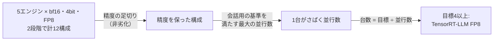
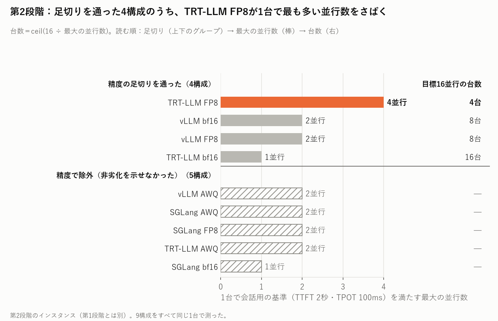
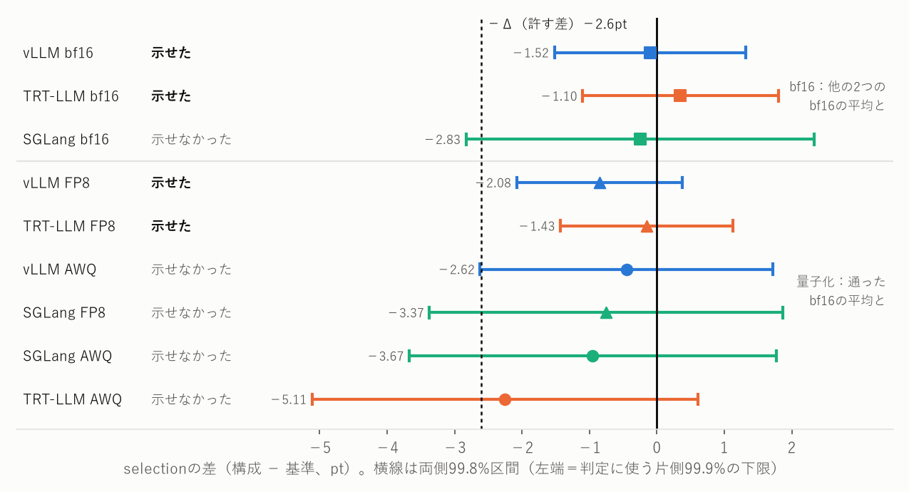
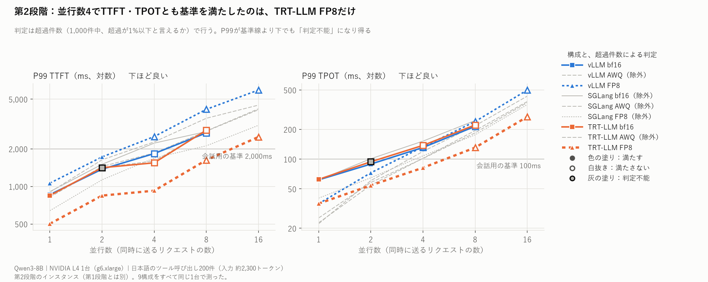

# toolcall-serving-bench ― 同じ8Bモデルを5つの推論エンジンで測り、精度の足切りの後にGPUの台数で構成を選んだ

同じモデル（Qwen3-8B）を、同じGPU（NVIDIA L4 1台）で、5つの推論エンジンと量子化の組み合わせに載せ、
**ツール呼び出し（function calling）の精度とレイテンシ**を測った。精度で足切りしてから、会話用の基準を満たす最大の並行数で台数を出し、台数が最も少ない構成を選んだ。
評価セットは、汎用ERPのツール群に対する日本語の200件を自作した。

> エンジンの速さの順位表ではない。L4 1台・このワークロード（約2,300トークンを読んで約40トークンを返す）の下で、
> **判定の規則を結果より先に決めて記録し、その規則どおりに構成を選ぶ**までの手順を示す。



---

## 結果サマリー

| 項目 | 値 |
| --- | --- |
| **選定** | **目標の並行数が4以上なら TensorRT-LLM FP8 が最も少ない台数**（並行数16で4台、vLLM bf16・FP8は8台）。2以下は同じ台数の構成が並び、決めない |
| 比べた構成（第2段階） | vLLM 0.31.0・SGLang 0.5.21・TensorRT-LLM 1.2.1 × bf16・AWQ・FP8 の9構成、L4 1台 |
| 精度の足切り | 9構成中4つが通った：vLLM bf16・FP8、TRT-LLM bf16・FP8 |
| 基準を満たす最大の並行数 | TRT-LLM FP8 4、vLLM bf16・FP8 2、TRT-LLM bf16 1 |
| 第1段階（transformers・llama.cpp・vLLM） | 目標4以上なら vLLM AWQ。条件の違う前の段階で、第2段階とは比べない（[詳しい結果](docs/results.md)） |
| GPUでの実行 | 計約86時間・約$102 |

**精度（selection）はどの構成も0.91〜0.94に収まり、台数の差は速さで付いた。**

| 用語 | 意味 |
| --- | --- |
| selection | 正しいツールを選べた割合（呼ぶべきでない場面で呼ばないことを含む） |
| 並行数 | 同時に送るリクエストの数 |
| 会話用の基準 | MLPerf InferenceのLlama 3.1 8B向け（TTFT 2,000ms・TPOT 100ms）。超過が1%以下と言えれば「満たす」 |
| 非劣化を示せた | 差の片側の下限が、許す差 −2.6pt（Qwen3-8Bと4BのBFCLの差）を上回った |
| 最大の並行数 | 並行数1から倍々に上げ、「満たす」が続いた最大の値 |

---

## 目標の並行数が4以上なら、TensorRT-LLM FP8 が最も少ない台数で済む

**足切りを通った4構成のうち、並行数16の目標で TRT-LLM FP8 は4台、vLLM bf16・FP8 は8台、TRT-LLM bf16 は16台になった。**



上から、足切りを通った構成（色＝選んだ構成、灰＝比べた構成）、精度で外れた構成（斜線）。右の列が目標16並行の台数。

| 目標の並行数 | 1 | 2 | 4 | 8 | 16 |
| --- | --- | --- | --- | --- | --- |
| TRT-LLM FP8（最大4） | 1 | 1 | **1** | **2** | **4** |
| vLLM bf16・FP8（最大2） | 1 | 1 | 2 | 4 | 8 |
| TRT-LLM bf16（最大1） | 1 | 2 | 4 | 8 | 16 |

```
台数 = ceil(目標の並行数 ÷ 1台で基準を満たす最大の並行数)
```

同じ台数なら並べて決めないことは、結果を見る前に決めた（[ADR-0008](docs/adr/0008-quantization-noninferiority.md)の追記）。

---

## 精度の足切りを通ったのは9構成中4つで、SGLangは差が小さくても示せなかった

**bf16は他の2エンジンのbf16の平均と、量子化は足切りを通ったbf16の平均と比べ、片側99.9%の下限が −2.6pt を上回った4構成が通った。**



区間の左端が網掛け（許す差 −2.6pt より左）に入らなければ「示せた」。

| 構成 | selection | 差 | 片側99.9%の下限 | 判定 |
| --- | --- | --- | --- | --- |
| vLLM bf16 | 0.933 | −0.10pt | −1.52pt | **示せた** |
| TRT-LLM bf16 | 0.936 | +0.35pt | −1.10pt | **示せた** |
| SGLang bf16 | 0.932 | −0.25pt | −2.83pt | 示せなかった |
| vLLM FP8 | 0.926 | −0.85pt | −2.08pt | **示せた** |
| TRT-LLM FP8 | 0.933 | −0.15pt | −1.43pt | **示せた** |
| vLLM AWQ | 0.930 | −0.45pt | −2.62pt | 示せなかった |
| SGLang FP8 | 0.927 | −0.75pt | −3.37pt | 示せなかった |
| SGLang AWQ | 0.925 | −0.95pt | −3.67pt | 示せなかった |
| TRT-LLM AWQ | 0.912 | −2.25pt | −5.11pt | 示せなかった |

SGLang bf16は差が小さいが、他の2エンジンと答えが食い違ったケースの割合（約4.9%）が、vLLMとTRT-LLMの間（0.9%）より大きく、区間が広がった。
上回った組と下回った組は26対27で、向きの偏りは無い。「劣る」ではなく「示せなかった」である。
SGLangはツール定義を書き換えて入力が約100トークン長くなり、これが原因と見ているが、計算のカーネルの違いとは切り分けていない（推定）。

---

## 速さでは、TRT-LLM FP8 だけが並行数4で基準を満たした

**並行数4で、TRT-LLM FP8は1,000件中0件の超過で「満たす」だった。ほかの8構成は並行数4で21〜809件を超えた。**



色がエンジン、線の形と印が量子化。印の塗りがそのセルの判定で、色の塗り＝満たす、白抜き＝満たさない、灰の塗り＝判定不能。
判定は超過件数で行うので、P99が基準線より下でも判定不能になり得る（TRT-LLM bf16の並行数2）。

| 構成 | 最大の並行数 | 次の並行数での超過 |
| --- | --- | --- |
| TRT-LLM FP8 | **4** | 並行数8で545/1,000 |
| vLLM bf16・FP8・AWQ | 2 | 並行数4で652・328・24/1,000 |
| SGLang AWQ・FP8 | 2 | 並行数4で105・35/1,000 |
| TRT-LLM AWQ | 2 | 並行数4で21/1,000 |
| TRT-LLM bf16・SGLang bf16 | 1 | 並行数2が判定不能（超過9・15/1,000） |

TTFT・TPOTの値、スループット、第1段階の結果は[詳しい結果](docs/results.md)にある。

---

## 方法

| 条件 | 値 |
| --- | --- |
| モデル・GPU | `Qwen/Qwen3-8B`（revision `b968826`）とその量子化、`g6.xlarge`（L4 24GB）1台。段階の中では全構成を同じ1台で測る |
| 評価セット | 日本語200件（うちツールを呼ぶべきでない30件）。架空のERPの40個のツールから、ケースごとに10個を提示（約2,300トークン） |
| 採点 | ツールの選択（selection）と引数（完全一致・意味の一致）を別々に採点し、選択を外したケースの引数はN/Aにする |
| 精度のセル | 並行数1、200件×5試行（ツールの並び順を試行ごとに変える）、greedy |
| 速さのセル | 1,000件＋ウォームアップ200件、並行数1・2・4・8・16。並行数を固定し、1件が返ったら次を送る |
| 記録 | セルごとに版・起動コマンド・ハードウェア・容量の判定をschemaで検証して残す。生出力を先に書くので、後から採点し直せる |

| 条件 | vLLM | SGLang | TensorRT-LLM |
| --- | --- | --- | --- |
| AWQ | `Qwen/Qwen3-8B-AWQ` | 同左 | ModelOpt 0.37.0の`int4_awq`で作った |
| FP8の計算 | W8A16（L4でFP8の計算をしない） | W8A8（ブロック単位） | W8A8（テンソル単位） |
| 入力トークン | 基準 | 約+100（ツール定義を書き換える） | 基準と同じ |
| 経路・設定 | 既定 | `--mem-fraction-static` 0.87 | `trtllm-serve`のPyTorchの経路（エンジンをビルドしない） |

規則と数値は結果を見る前にADRで決め、見た後に決めたことはADRの追記に明記した。第1段階を第2段階の規則で判定し直すことはしない。

| 判定 | 規則 | なぜその値か | 記録 |
| --- | --- | --- | --- |
| 許す差 | −2.6pt（selection） | Qwen3-8Bと4BのBFCL v3の差。モデルを1段階小さくしたのと同じだけの劣化までは許す | [ADR-0002](docs/adr/0002-equivalence-margin.md) |
| 足切り | 片側99.9%のt区間の下限 > −2.6pt。基準はbf16の平均 | 特定のエンジンを判定されない基準にしないため。どの不一致の割合でも誤りの率が2.5%以下になる信頼度をシミュレーションで選んだ（最悪2.3%、`scripts/gate_simulation.py`） | [ADR-0009](docs/adr/0009-batching-engines.md) |
| 速さ | 超過率が1%以下かを、Clopper-Pearsonの片側95%で3値（満たす／満たさない／判定不能） | P99で基準を満たすことに当たる。基準はMLPerf InferenceのLlama 3.1 8B向け | [ADR-0003](docs/adr/0003-latency-pass-verdict.md) |
| 選定 | 足切り → 最大の並行数 → 台数が最も少ない構成 | 目標の並行数を先に決めなかったので、目標ごとの表で示す | [ADR-0008](docs/adr/0008-quantization-noninferiority.md) |

評価セットの作り方（正解はスクリプトが作り、クエリはLLMが書き、全件を人が確認した）は[詳しい結果](docs/results.md#評価セットと採点)にある。

---

## 限界と範囲外

| 項目 | 何が言えないか | 結論への影響 | 根拠 |
| --- | --- | --- | --- |
| インスタンスによる差 | 各構成を1台で測った。第1段階では、同じ構成の並行数4の超過が、別のインスタンスで2 → 59/1,000に変わった（SMクロックが約12%低い） | 境目に近い構成（並行数4で超過21〜35）の順位は、インスタンスで入れ替わり得る。TRT-LLM FP8の並行数4（0件）は境目から遠い | [ADR-0007](docs/adr/0007-main-run-layout.md) |
| 負荷のかけ方 | 並行数を固定する送り方だけ。MLPerfのServerのようなランダムな到着（ポアソン）は測っていない | 「1秒にX件届くなら何台」には読み替えない | [ADR-0003](docs/adr/0003-latency-pass-verdict.md)の追記2026-10-27 |
| FP8の計算方式 | vLLMはW8A16、SGLang・TRT-LLMはW8A8 | 各エンジンの公式の経路で動くものの比較として読む | [疎通の記録](docs/gpu-smoke-batching-2026-10-28.md) |
| TensorRT-LLMの経路 | エンジンをビルドする経路の方が速い可能性がある | TRT-LLMの値はPyTorchの経路の値 | ADR-0009 |
| SGLangの入力 | 1件あたり約100トークン長い | この違いを含んだエンジンの振る舞いとして測った | [docs/engines.md](docs/engines.md) |
| 条件の幅 | GPUはL4、モデルはQwen3-8Bだけ。設定は既定のまま | 他のGPU・モデル・設定では順位が変わり得る | ADR-0009 |
| ワークロード | ツールを1回呼ぶまで（単発）。ケースごとに10個のツールを渡す構成で、プレフィックスキャッシュはほぼ効かない（4.7〜9.0%） | ツール一式を固定してキャッシュが効く構成では、順位が変わり得る | [ADR-0003](docs/adr/0003-latency-pass-verdict.md)の追記2026-10-24 |
| 評価セット | 架空のERPの40個のツール。200件中186件のクエリはLLMが書いた | 業務の実データでの精度ではない | [ADR-0004](docs/adr/0004-expand-case-set.md) |

---

## 動かし方

手元（GPU不要）：

```bash
pip install -r requirements.txt pytest
python -m pytest -q                       # PRごとにCIでも回る
```

1セルの実行（エンジンのサーバーが`localhost:8000`で立っている前提）と、精度の足切り：

```bash
python scripts/run_cell.py --pass-type accuracy --engine vllm \
    --base-url http://localhost:8000 --model Qwen/Qwen3-8B --quantization bf16-none \
    --engine-version 0.31.0 --tool-stage 10
python scripts/noninferiority.py --batching runs/<回収したフォルダ>
```

GPUインスタンスでの実行（apply → 準備 → セルの一覧を回す → 回収 → destroy）は[docs/gpu-runbook.md](docs/gpu-runbook.md)の手順で行う。
READMEの図は`python scripts/plot_results.py`で作り直せる。
本番4回分の生の記録（manifest・生出力・実行条件）は[Release `runs-2026-10`](https://github.com/yuya0408/toolcall-serving-bench/releases/tag/runs-2026-10)にあり、`runs/`に展開すると上の足切りを作り直せる。

## ディレクトリ構成

| 場所 | 中身 |
| --- | --- |
| `data/`・`schema/` | 評価セット、事例とrun manifestのschema、ツールカタログ |
| `eval_bench/` | ハーネス本体（エンジンごとのadapter、分離採点、レイテンシ、容量の判定、セルの実行） |
| `scripts/` | セルの実行・足切り・図の作成・評価セットの生成。`scripts/gpu/`はGPUインスタンスでの手順 |
| `infra/` | Terraform（GPUインスタンス） |
| `docs/` | [詳しい結果](docs/results.md)、ADR、GPUでの実行の記録（`gpu-*.md`）、エンジンごとの違い（`engines.md`）、図 |

## 判断の記録

数字と方針の根拠は、却下した案とともにADRに残している。

| ADR | 決めたこと | 状態 |
| --- | --- | --- |
| [0001](docs/adr/0001-ci-regression-threshold.md) | CIの回帰ゲートのしきい値 | Proposed（ゲートは未実装） |
| [0002](docs/adr/0002-equivalence-margin.md) | 許す差を±2.6pt（モデル1段階分の差）に固定する | Accepted |
| [0003](docs/adr/0003-latency-pass-verdict.md) | レイテンシは、MLPerfの8B向け基準を満たすかの3値で判定する | Accepted |
| [0004](docs/adr/0004-expand-case-set.md) | 評価セットを200件に増やす（正解は機械で作り、クエリはLLMが書く） | Accepted |
| [0005](docs/adr/0005-capacity-check.md) | 並行数のセルが成り立つかを、全エンジン共通の容量の判定で確かめる | Accepted |
| [0006](docs/adr/0006-pin-engine-versions.md) | エンジンの版を固定する | Accepted |
| [0007](docs/adr/0007-main-run-layout.md) | 本番の分け方、レイテンシを1台にまとめること、セルの順番 | Accepted |
| [0008](docs/adr/0008-quantization-noninferiority.md) | 量子化の非劣化を確かめ、精度の足切りと台数で構成を選ぶ（第1段階） | Accepted |
| [0009](docs/adr/0009-batching-engines.md) | 連続バッチングの3エンジンを1台で比べ、bf16どうしを互いの基準にした足切りで選ぶ（第2段階） | Accepted |

## ライセンス・出典

コードと評価セット（`data/`・`schema/`）は[MITライセンス](LICENSE)。
`grounded`の事例は、EDINETで公開されている有価証券報告書と、自治体の例規集を、文書の種類と年度の例として参照している（本文は収録していない）。
