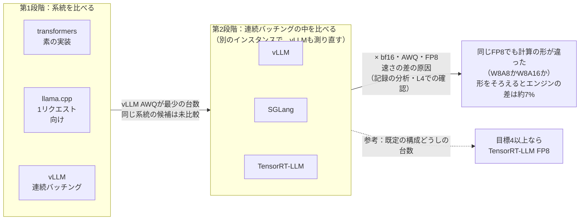
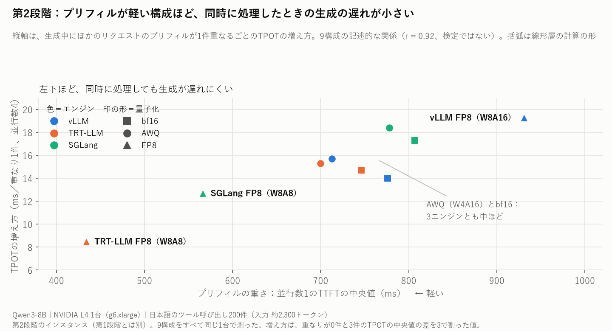
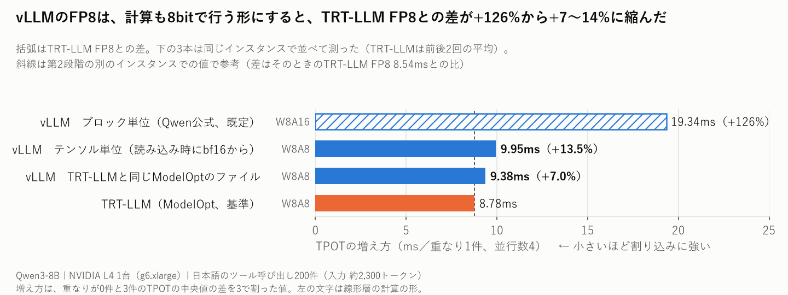
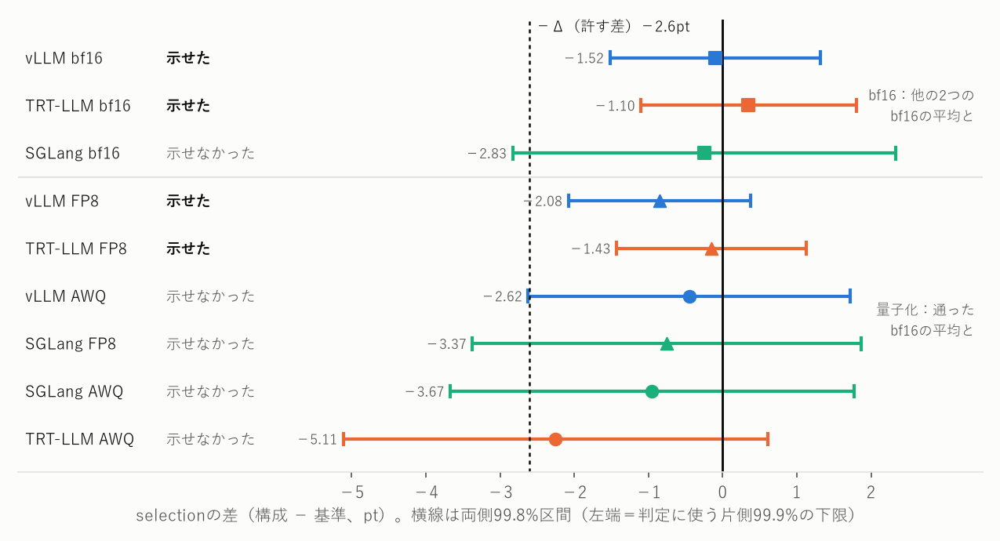
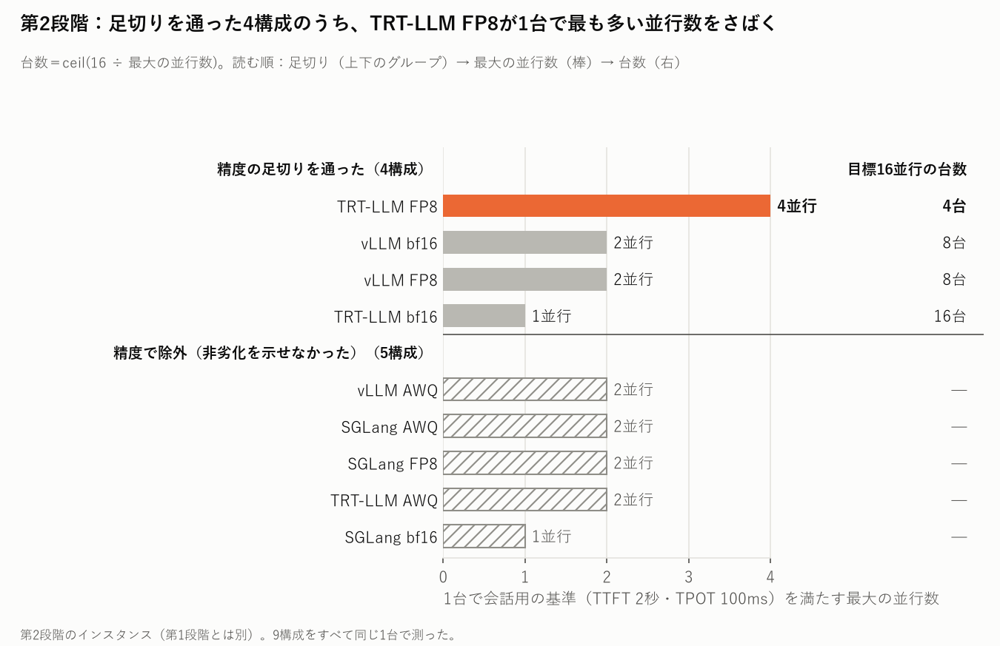

# toolcall-serving-bench ― 同じGPU（L4）で5つの推論エンジンを既定のまま動かすと、同じ「FP8」でも計算の形が違い、それが応答速度の差の大部分を占めた

NVIDIA GPUで推論エンジンを選ぶとき、何を見て、何に注意すべきか。同じモデル（Qwen3-8B）を、同じGPU（NVIDIA L4 1台）で、5つの推論エンジンと量子化の組み合わせに載せ、
**ツール呼び出し（function calling）の精度とレイテンシ**を測った。精度で足切りしてから、会話用の基準を満たす最大の並行数でGPUの台数を出して構成を選び、速さの差の原因を記録から分析して、L4で条件を変えて確かめた。
評価セットは、汎用ERPのツール群に対する日本語の200件を自作した。

> エンジンの速さの順位表ではない。L4 1台・このワークロード（約2,300トークンを読んで約40トークンを返す。プリフィルが律速）で、速さの差が何で決まったかを示す。
> 条件を変えて確かめたのはFP8の計算の形（1件ずつのプリフィル・並行数4・精度）だけで、ほかの要因は記録の分析による（[限界と範囲外](#限界と範囲外)）。



---

## 結果サマリー

**精度（selection）はどの構成も0.91〜0.94に収まり、台数の差は速さで付いた。速さの差は、エンジンの違いよりも、量子化がプリフィルの計算まで軽くするか（計算の形）で付いた。既定のままだと、同じ「FP8」でもエンジンごとに計算の形が違った。**

| 見るべき点 | このワークロードで分かったこと |
| --- | --- |
| **律速** | **プリフィルの計算。** 並行数4の超過はほぼTPOTの側で、ほかのリクエストのプリフィルが生成に割り込むほど増えた |
| 量子化の計算の形 | プリフィルまで軽くしたのは、計算も8bitで行うFP8（W8A8）だけ。AWQ（W4A16）は生成が最速でも、プリフィルは16bitのまま |
| 同じ「FP8」 | 既定のままだと、vLLMはQwen公式のブロック単位のFP8をL4でW8A16で動かし（TRT-LLM・SGLangはW8A8）、並行数1のTTFTはTRT-LLM FP8の2倍強だった（931 対 434ms） |
| 形をそろえたときのエンジンの差 | vLLMもテンソル単位のW8A8にすると、並行数4の割り込みはTRT-LLM FP8との差が+13.5%まで縮み、精度も落ちなかった。同じファイルを読ませると+7.0% |
| bf16でのエンジンの差 | 精度も速さもほぼ同じ（selection 0.932〜0.936、並行数1のTTFT 746〜807ms） |
| エンジンの既定値 | プリフィルと生成の組み方（分けるか、同じステップに混ぜるか）や、ツール定義の扱い（SGLangだけ入力が+100トークン）がエンジンごとに違う |
| 精度の比較 | 入力のわずかな差で答えの食い違いが約5倍になり、平均の精度が同じでも非劣化を示せなかった（SGLang bf16） |
| 選定（参考。第2段階、9構成） | 既定の構成どうしでは、目標の並行数が4以上なら TensorRT-LLM FP8 が最少の台数（並行数16で4台）。計算の形がそろっていないので、参考の値 |
| 第1段階（transformers・llama.cpp・vLLM） | 目標4以上なら vLLM AWQ。条件の違う前の段階で、第2段階とは比べない（[詳しい結果](docs/results.md)） |
| GPUでの実行 | 計約91時間・約$108 |

| 用語 | 意味 |
| --- | --- |
| selection | 正しいツールを選べた割合（呼ぶべきでない場面で呼ばないことを含む） |
| 並行数 | 同時に処理中のリクエストの数（1件返ると次を送る）。利用者数ではない |
| 会話用の基準・最大の並行数 | MLPerf InferenceのLlama 3.1 8B向け（TTFT 2,000ms・TPOT 100ms）。超過が1%以下と言えれば「満たす」。並行数1から倍々に上げて「満たす」が続いた最大の値が最大の並行数 |
| 非劣化を示せた | 差の片側の下限が、許す差 −2.6pt（Qwen3-8Bと4BのBFCLの差）を上回った |
| プリフィル | 入力を読む段階（TTFTまで）。行列の計算が律速になる。その後の生成（TPOT）はメモリの転送が律速になる |
| W8A8・W8A16・W4A16 | 線形層の重み（W）と計算（A）のビット数。W8A16は重みを8bitで持ち、16bitに戻して計算する |

---

## 律速はプリフィルの計算で、プリフィルが軽い構成ほど同時に処理しても生成が遅れにくかった

**並行数4の超過はほぼTPOTの側だった。プリフィルの重さと、それが生成に割り込んだときの遅れは、9構成でそろって動いた（r = 0.92、記述的）。**



左下ほど良い。縦軸は、生成中にほかのリクエストのプリフィルが1件重なるごとのTPOTの増え方。

| 量子化の計算の形 | 構成 | 並行数1のTTFT | 重なり1件ごとのTPOTの増え方 | 並行数4の超過（1,000件中） |
| --- | --- | --- | --- | --- |
| W8A8 | TRT-LLM FP8・SGLang FP8 | 434・566ms | +8.5・+12.7ms | **0**・35 |
| W4A16（AWQ） | 3エンジン | 700〜778ms | +15.3〜18.4ms | 21〜105 |
| bf16 | 3エンジン | 746〜807ms | +14.0〜17.3ms | 652〜809 |
| W8A16 | vLLM FP8 | 931ms | +19.3ms | 328 |

並行数4では、多くのリクエストが生成中に約3件のプリフィルと重なり、TPOTはおおよそ「重なりが無いときのTPOT ＋ 3 × 増え方」になった。
AWQは単独の生成が最も速い（TPOT 22〜25ms）ので持ちこたえたが、プリフィルは16bitのままで、割り込みで裾が超えた（値の出し方は[原因の分析](docs/analysis-batching.md#並行数4の超過はプリフィルの割り込みで決まる)）。

---

## 同じ「FP8」でも、エンジンの既定のままでは計算の形が違い、形をそろえるとエンジンの差は小さい

**vLLMは、Qwen公式のブロック単位のFP8を、L4ではカーネルの優先順位でW8A16にした。SGLangとTRT-LLMはW8A8で計算した。**

| 条件 | vLLM 0.31.0 | SGLang 0.5.21 | TensorRT-LLM 1.2.1 |
| --- | --- | --- | --- |
| FP8のチェックポイント | `Qwen/Qwen3-8B-FP8`（ブロック単位） | 同左 | ModelOpt 0.37.0で作ったテンソル単位 |
| L4（sm_89）での計算の形 | W8A16（Marlin。ブロック単位のW8A8カーネルはsm_90以上が条件） | W8A8 | W8A8 |
| AWQのチェックポイント | `Qwen/Qwen3-8B-AWQ` | 同左 | ModelOpt 0.37.0の`int4_awq`で作った |
| プリフィルと生成の組み方（既定） | 2,048トークンずつに分け、生成と同じステップに混ぜる | 4,096ずつに分け、生成とは別のステップにする（`enable_mixed_chunk` False） | 分けない（`enable_chunked_prefill` False）。1ステップ最大8,192トークン |
| 入力トークン | 基準 | 約+100（ツール定義を自分の型に読み込んで書き戻す） | 基準と同じ |
| 経路・設定 | 既定 | `--mem-fraction-static` 0.87 | `trtllm-serve`のPyTorchの経路（エンジンをビルドしない） |

第2段階のTRT-LLM FP8とvLLM FP8の差は、エンジンの差と計算の形の差を含んでいた（[ADR-0009](docs/adr/0009-batching-engines.md)の追記A5）。後からL4で、形をそろえて確かめた（並行数4はTRT-LLM FP8と同じインスタンスで。[1件ずつのプリフィル](docs/analysis-batching.md#l4で確かめた2026-11-19)・[並行数4](docs/analysis-batching.md#並行数4で確かめた2026-11-23)）：



棒は、並行数4で重なり1件ごとのTPOTの増え方。差の大部分は計算の形で、同じファイルでも残る+7.0%がエンジンの差（プリフィルと生成の組み方などを含み、分けていない）。精度の足切りは、ブロック単位（−2.08pt）もテンソル単位（−2.17pt）も示せた（同じファイルは測っていない）。

---

## 精度の比較は、入力のわずかな差で判定が変わった

**SGLang bf16は平均の精度が同じでも、入力が100トークン長く、ほかの2エンジンと答えが食い違ったケースの割合が約5倍になり、非劣化を示せなかった。**



区間の左端が網掛け（許す差 −2.6pt より左）に入らなければ「示せた」。

| 構成 | selection | 他の2エンジンと答えが食い違った組の割合 | 片側99.9%の下限 | 判定 |
| --- | --- | --- | --- | --- |
| vLLM bf16 | 0.933 | 0.9%（TRT-LLMと）・4.9%（SGLangと） | −1.52pt | **示せた** |
| TRT-LLM bf16 | 0.936 | 0.9%・4.8% | −1.10pt | **示せた** |
| SGLang bf16 | 0.932 | 4.9%・4.8% | −2.83pt | 示せなかった |

食い違いは、ほぼ全部が紛らわしいツールの取り違えで、向きは半々（上回った組と下回った組が26対27）だった。「劣る」ではなく「示せなかった」である。
足切りの区間は差のばらつきから作るので、平均の差だけでなく、ほかと答えが一致するかにも左右される。量子化を含む9構成の判定は[詳しい結果](docs/results.md)にある。

---

## 参考：各エンジンの既定の構成どうしで選ぶと

既定の構成どうしで「足切り → 最大の並行数 → 台数」の順に選ぶと、目標の並行数が4以上ならTRT-LLM FP8が最少の台数になった。ただし計算の形がそろっていない（vLLM FP8はW8A16、AWQはTRT-LLMだけModelOptで作ったチェックポイント）ので、参考の値にとどめ、エンジンの優劣としては読まない（[上の節](#同じfp8でもエンジンの既定のままでは計算の形が違い形をそろえるとエンジンの差は小さい)）。形をそろえた後の台数は確かめていない。



上から、足切りを通った構成（色＝選んだ構成、灰＝比べた構成）、精度で外れた構成（斜線）。右の列が目標16並行の台数（`ceil(16 ÷ 最大の並行数)`）。

---

## 方法

| 条件 | 値 |
| --- | --- |
| モデル・GPU | `Qwen/Qwen3-8B`（revision `b968826`）とその量子化、`g6.xlarge`（L4 24GB）1台。段階の中では全構成を同じ1台で測る |
| ドライバ・CUDA | NVIDIAドライバは第1段階が595.91.07、第2段階が595.112.07（AMIをapplyのたびに最新版で取ったため）。CUDAは13.2。比べる組み合わせは段階の中で閉じていて、段階をまたいでは比べない |
| 評価セット | 日本語200件（うちツールを呼ぶべきでない30件）。架空のERPの40個のツールから、ケースごとに10個を提示（約2,300トークン） |
| 採点 | ツールの選択（selection）と引数（完全一致・意味の一致）を別々に採点し、選択を外したケースの引数はN/Aにする |
| 精度のセル | 並行数1、200件×5試行（ツールの並び順を試行ごとに変える）。判定に使うのはgreedy（temperature 0.7の普通の精度も参考に測った） |
| 速さのセル | 1,000件＋ウォームアップ200件、並行数1・2・4・8・16。並行数を固定し、1件が返ったら次を送る |
| 記録 | セルごとに版・起動コマンド・ハードウェア・容量の判定をschemaで検証して残す。生出力を先に書くので、後から採点し直せる |

エンジンごとに違った条件は[上の表](#同じfp8でもエンジンの既定のままでは計算の形が違い形をそろえるとエンジンの差は小さい)にある。
規則と数値は結果を見る前にADRで決め、見た後に決めたことはADRの追記に明記した。第1段階を第2段階の規則で判定し直すことはしない。原因の分析は判定を変えない。

精度は、bf16の平均を基準にした差の片側99.9%のt区間の下限が、許す差 −2.6pt（Qwen3-8Bと4BのBFCL v3の差）を上回れば足切りを通す。速さは、超過率が1%以下かをClopper-Pearsonの片側95%で「満たす／満たさない／判定不能」の3値で判定する（基準はMLPerf InferenceのLlama 3.1 8B向け）。値の理由と却下した案は[ADR-0002](docs/adr/0002-equivalence-margin.md)・[0003](docs/adr/0003-latency-pass-verdict.md)・[0009](docs/adr/0009-batching-engines.md)に、規則の一覧は[詳しい結果](docs/results.md#判定の規則の一覧)にある。

評価セットの作り方（正解はスクリプトが作り、クエリはLLMが書き、全件を人が確認した）は[詳しい結果](docs/results.md#評価セットと採点)にある。

---

## 限界と範囲外

| 項目 | 何が言えないか |
| --- | --- |
| 原因の分析 | 条件を変えて確かめたのはvLLM FP8の計算の形だけ（並行数4は各構成1回）。ほかの要因は記録の上での関連で、台数は確かめ直していない |
| インスタンスによる差 | 各構成を1台で測った。同じ構成でも、別のインスタンスで並行数4の超過が2 → 59/1,000に変わった例があり、境目に近い構成の順位は入れ替わり得る |
| 条件の幅 | L4・Qwen3-8B・既定の設定、ツールを1回呼ぶまでの単発、並行数を固定する送り方だけ。ほかのGPU・キャッシュが効く構成・ランダムな到着では、律速も順位も変わり得る |
| 評価セット | 架空のERPの40個のツールで、200件中186件のクエリはLLMが書いた。業務の実データでの精度ではない |

TensorRT-LLMの経路などほかの留保は[詳しい結果](docs/results.md#細かい留保)に、TTFT・TPOTの値、スループット、9構成の足切りと速さの判定、第1段階の結果も[詳しい結果](docs/results.md)にある。

---

## 動かし方

手元（GPU不要）：

```bash
pip install -r requirements-dev.txt          # 実行だけならrequirements.txt。numpy・scipy・matplotlibはテストと図だけで使う
python -m pytest -q                       # PRごとにCIでも回る。保存済みの8Bの答えで、並び順・リクエスト・読み取り・採点を全件照合する（ADR-0010）
```

1セルの実行（エンジンのサーバーが`localhost:8000`で立っている前提）と、精度の足切り：

```bash
python scripts/run_cell.py --pass-type accuracy --engine vllm \
    --base-url http://localhost:8000 --model Qwen/Qwen3-8B --quantization bf16-none \
    --engine-version 0.31.0 --tool-stage 10
python scripts/noninferiority.py --batching runs/<回収したフォルダ>
```

GPUインスタンスでの実行（apply → 準備 → セルの一覧を回す → 回収 → destroy）は[docs/gpu-runbook.md](docs/gpu-runbook.md)の手順で行う。
READMEの図は`python scripts/plot_results.py`で作り直せる（図の値は、`--check runs/`で生の記録と照合できる）。
本番4回分の生の記録（manifest・生出力・実行条件）は[Release `runs-2026-10`](https://github.com/yuya0408/toolcall-serving-bench/releases/tag/runs-2026-10)にあり、`runs/`に展開すると上の足切りを作り直せる。

## ディレクトリ構成

| 場所 | 中身 |
| --- | --- |
| `data/`・`schema/` | 評価セット、事例とrun manifestのschema、ツールカタログ |
| `eval_bench/` | ハーネス本体（エンジンごとのadapter、分離採点、レイテンシ、容量の判定、非劣化と足切りの判定、ゴールデンの照合） |
| `scripts/` | コマンド（セルの実行・足切り・図の作成・評価セットの生成）とシミュレーション。`scripts/gpu/`はGPUインスタンスでの手順 |
| `infra/` | Terraform（GPUインスタンス） |
| `docs/` | [詳しい結果](docs/results.md)、[原因の分析](docs/analysis-batching.md)、ADR、GPUでの実行の記録（`gpu-*.md`）、エンジンごとの違い（`engines.md`）、図 |

## 判断の記録

数字と方針の根拠は、却下した案とともにADRに残している（[一覧](docs/adr/README.md)）。中心は、許す差を±2.6ptに固定した[ADR-0002](docs/adr/0002-equivalence-margin.md)、レイテンシの3値判定の[ADR-0003](docs/adr/0003-latency-pass-verdict.md)、構成の選び方の[ADR-0008](docs/adr/0008-quantization-noninferiority.md)・[ADR-0009](docs/adr/0009-batching-engines.md)。

## ライセンス・出典

コードと評価セット（`data/`・`schema/`）は[MITライセンス](LICENSE)。
モデルの重みはこのリポジトリでもReleaseでも配っていない（使ったQwen3-8Bとその量子化は、それぞれの配布元のライセンス。Qwen3はApache-2.0）。
`grounded`の事例は、EDINETで公開されている有価証券報告書と、自治体の例規集を、文書の種類と年度の例として参照している（本文は収録していない）。
