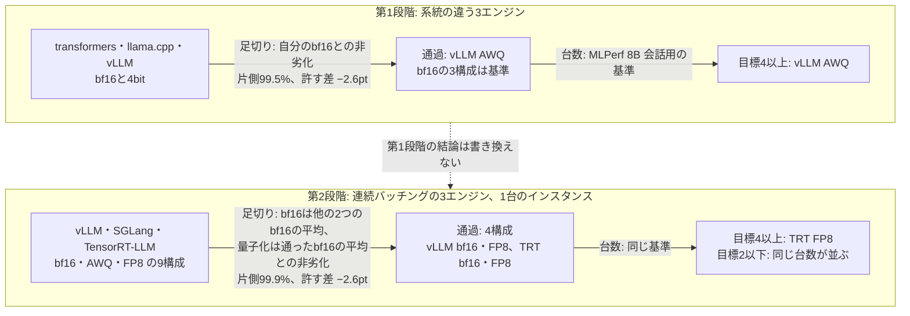
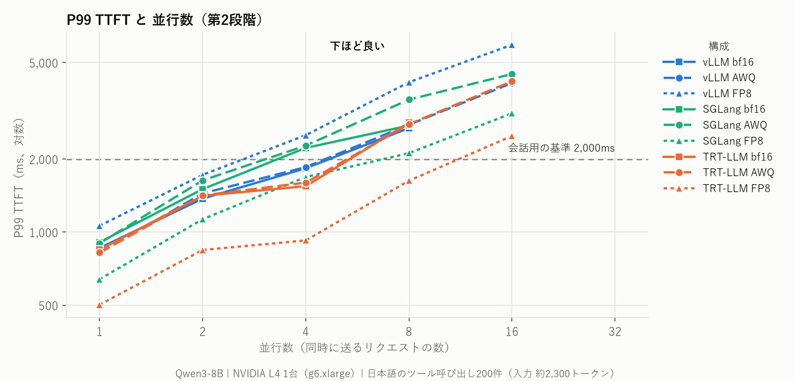
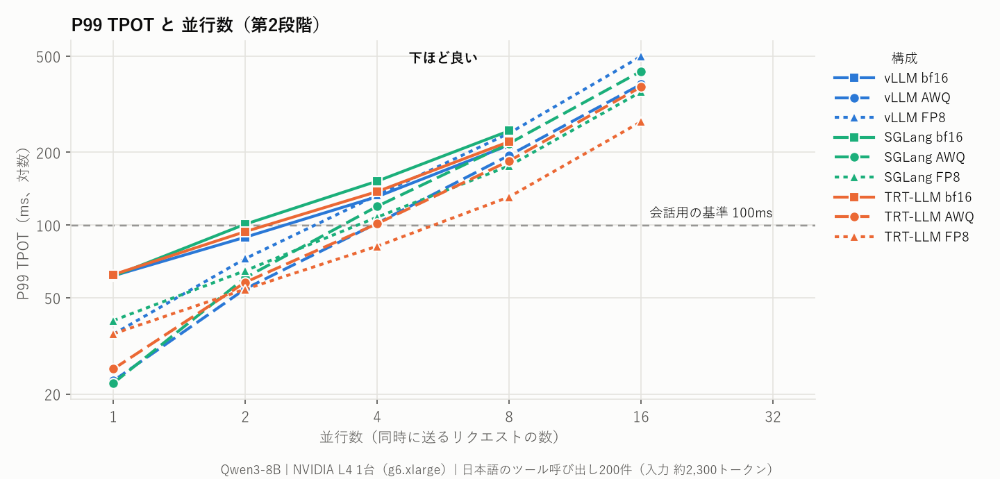
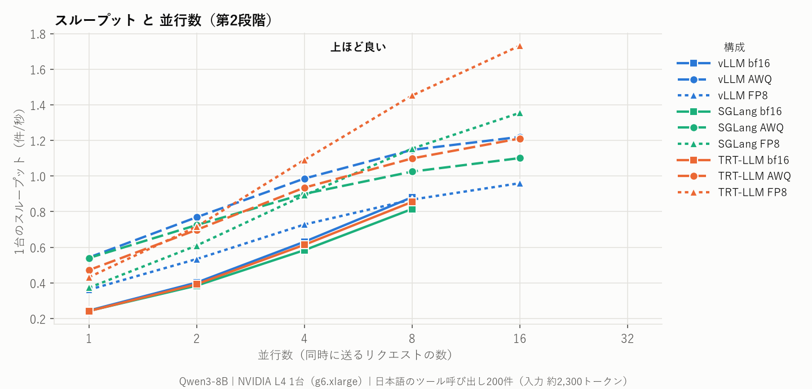
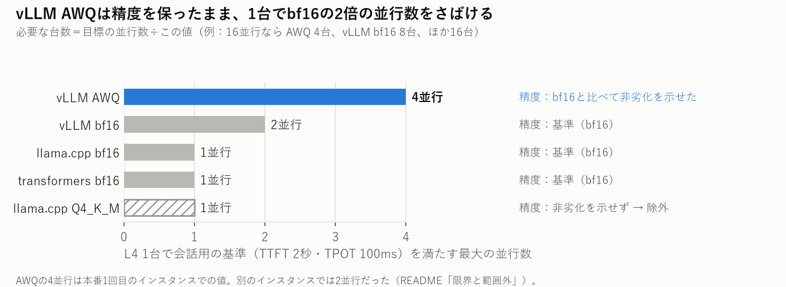
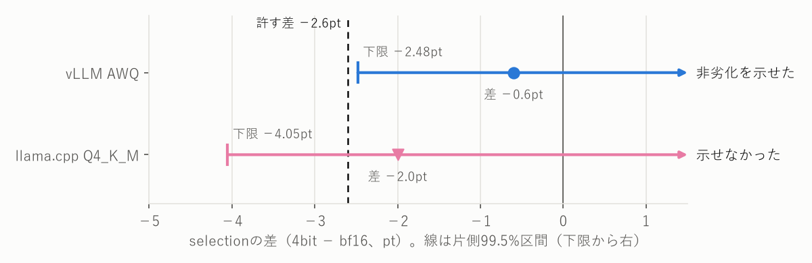
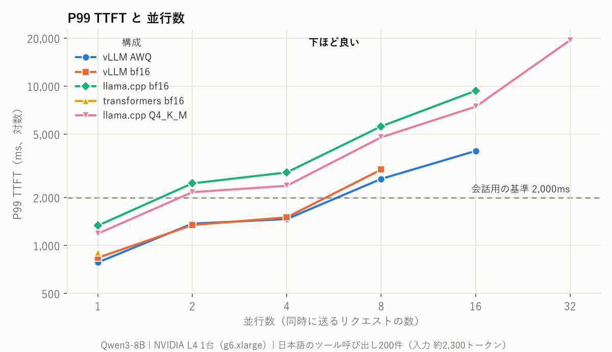
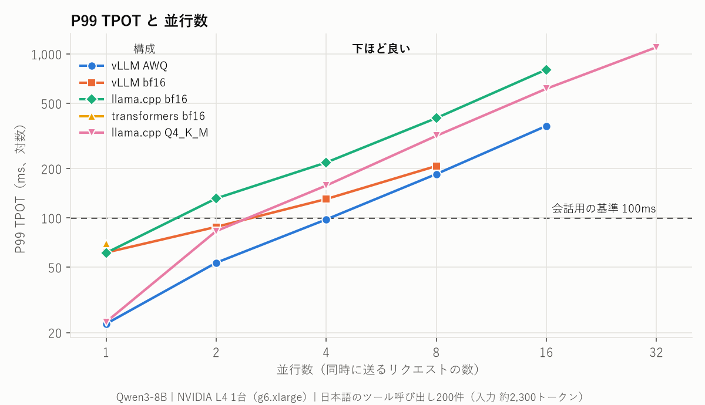
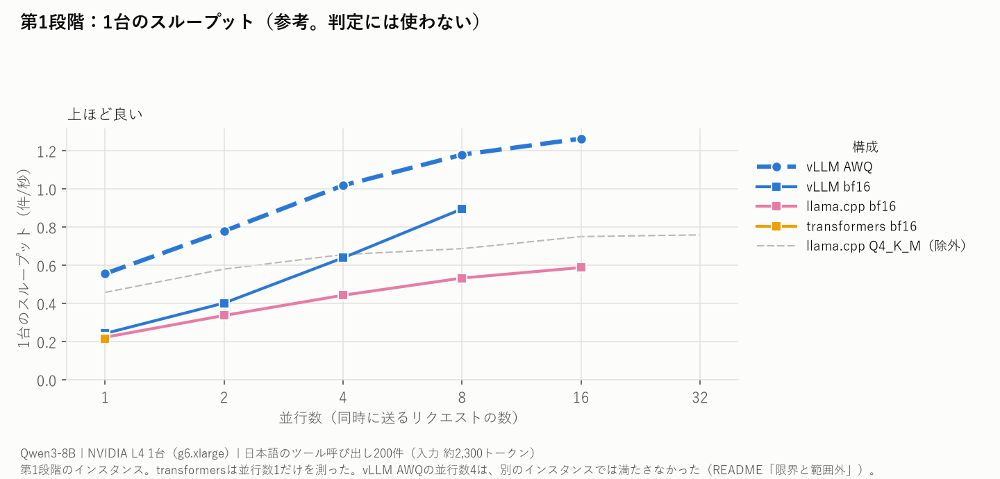

# toolcall-serving-bench ― 同じ8Bモデルを5つの推論エンジンで測り、目標の並行数が4以上ならTensorRT-LLM FP8がGPUの台数を最も減らした

同じモデル（Qwen3-8B）を、同じGPU（NVIDIA L4 1台）で、5つの推論エンジンと量子化の組み合わせに載せ、
**ツール呼び出し（function calling）の精度とレイテンシ**を測った。精度で足切りしてから、会話用の基準を満たす最大の並行数で台数を出し、台数が最も少ない構成を選んだ。
評価セットは、汎用ERPのツール群に対する日本語の200件を自作した。

> エンジンの速さの順位表を作るプロジェクトではない。L4 1台・このワークロード（約2,300トークンを読んで約40トークンを返す）の下で、
> **判定の規則を結果より先に決めて記録し、その規則どおりに構成を選ぶ**までの手順を示す。
> 2つの段階はインスタンスと足切りの規則が違うので、段階をまたいだ比較はしない。



---

## 結果サマリー

| 項目 | 値 |
| --- | --- |
| モデル・GPU | Qwen3-8B、`g6.xlarge`（NVIDIA L4 24GB）1台、ap-northeast-1 |
| 評価セット | 日本語200件（うちツールを呼ぶべきでない30件）。40個のツールから10個を提示 |
| **第1段階**（2026-10-18〜26） | transformers 5.17.0・llama.cpp `848bbda`・vLLM 0.31.0 |
| 4bitの非劣化（片側99.5%） | vLLM AWQ：示せた（下限 −2.48pt）／llama.cpp Q4_K_M：示せなかった（下限 −4.05pt） |
| 基準を満たす最大の並行数 | vLLM AWQ 4、vLLM bf16 2、llama.cpp（bf16・Q4_K_M）・transformers 1 |
| 選定 | 目標の並行数が4以上なら vLLM AWQ（並行数16で4台、vLLM bf16は8台） |
| 負荷の下の精度 | 並行数1と16で答えが変わらない（等価）とは、どの構成も示せなかった |
| **第2段階**（2026-10-27〜29） | vLLM 0.31.0・SGLang 0.5.21・TensorRT-LLM 1.2.1（PyTorchの経路）× bf16・AWQ・FP8 |
| 足切り（片側99.9%） | 通過は9構成中4：vLLM bf16・vLLM FP8・TRT bf16・TRT FP8。SGLangは3構成とも、AWQは3エンジンとも示せなかった |
| 基準を満たす最大の並行数 | TRT FP8 4、vLLM bf16・FP8 2、TRT bf16 1 |
| 選定 | **目標の並行数が4以上なら TRT FP8 が最も少ない台数**（並行数16で4台、vLLM bf16・FP8は8台）。2以下は同じ台数の構成が並び、決めない |
| 第1段階の vLLM AWQ は | 第2段階では足切りを通らず（下限 −2.62pt）、並行数4も満たさなかった（超過24/1,000）。第1段階の結論は、その段階の規則によるもので書き換えない |
| GPUでの実行 | 9回のapply、計約86時間・約$102 |

| 用語 | 意味 |
| --- | --- |
| 並行数 | 同時に送るリクエストの数 |
| selection | 正しいツールを選べた割合（呼ぶべきでない場面で呼ばないことを含む） |
| 会話用の基準 | MLPerf InferenceのLlama 3.1 8B向け（TTFT 2,000ms・TPOT 100ms）。超過が1%以下と言える（Clopper-Pearsonの片側95%）なら「満たす」 |
| 非劣化を示せた | 差の片側t区間の下限が、許す差 −2.6pt（Qwen3-8Bと4BのBFCLの差）を上回った |
| 足切り | 精度で非劣化を示せた構成だけを、台数の比較に進める |
| 最大の並行数 | 並行数1から倍々に上げ、「満たす」が続いた最大の値 |

---

## 目標の並行数が4以上なら、TensorRT-LLM FP8 が最も少ない台数で済む

**第2段階で足切りを通った4構成のうち、並行数16の目標で TRT FP8 は4台、vLLM bf16・FP8 は8台、TRT bf16 は16台になった。**


塗りつぶしの棒が足切りを通った構成、斜線は精度で外れた構成。

| 目標の並行数 | 1 | 2 | 4 | 8 | 16 |
| --- | --- | --- | --- | --- | --- |
| TRT FP8（最大4） | 1 | 1 | **1** | **2** | **4** |
| vLLM bf16（最大2） | 1 | 1 | 2 | 4 | 8 |
| vLLM FP8（最大2） | 1 | 1 | 2 | 4 | 8 |
| TRT bf16（最大1） | 1 | 2 | 4 | 8 | 16 |
| 最も少ない構成 | 4構成が同じ | TRT FP8・vLLM bf16・vLLM FP8 が同じ | TRT FP8 | TRT FP8 | TRT FP8 |

```
台数 = ceil(目標の並行数 ÷ 1台で基準を満たす最大の並行数)
TRT FP8        : ceil(16 ÷ 4) = 4
vLLM bf16・FP8 : ceil(16 ÷ 2) = 8
TRT bf16       : ceil(16 ÷ 1) = 16
```

同じ台数なら並べて決めないことは、結果を見る前に[ADR-0008](docs/adr/0008-quantization-noninferiority.md)の追記で決めた。
FP8の計算方式はエンジンで違い（vLLMはL4でW8A16、TRTはW8A8）、TRTはエンジンをビルドしない経路で測った（「[方法](#方法)」の対象ごとの条件）。

---

## 第2段階の足切りを通ったのは9構成中4つで、SGLangは差が小さくても示せなかった

**bf16は他の2つのエンジンのbf16の平均と、量子化は足切りを通ったbf16（vLLM・TRT）の平均と比べ、片側99.9%の下限が −2.6pt を上回った4構成が通った。**


区間の左端が −Δ の点線より右にあれば「示せた」。

| 構成 | selection | 差 | 片側99.9%の下限 | 基準との不一致 | 判定 |
| --- | --- | --- | --- | --- | --- |
| vLLM bf16 | 0.933 | −0.10pt | −1.52pt | 4.9%・0.9% | **示せた** |
| TRT bf16 | 0.936 | +0.35pt | −1.10pt | 0.9%・4.8% | **示せた** |
| SGLang bf16 | 0.932 | −0.25pt | −2.83pt | 4.9%・4.8% | 示せなかった |
| vLLM FP8 | 0.926 | −0.85pt | −2.08pt | 1.7%・1.6% | **示せた** |
| TRT FP8 | 0.933 | −0.15pt | −1.43pt | 1.8%・1.5% | **示せた** |
| vLLM AWQ | 0.930 | −0.45pt | −2.62pt | 4.7%・4.2% | 示せなかった |
| SGLang FP8 | 0.927 | −0.75pt | −3.37pt | 5.8%・5.5% | 示せなかった |
| SGLang AWQ | 0.925 | −0.95pt | −3.67pt | 6.0%・5.9% | 示せなかった |
| TRT AWQ | 0.912 | −2.25pt | −5.11pt | 5.7%・5.8% | 示せなかった |

不一致は、基準のそれぞれと(ケース, 試行)ごとの正誤が食い違った割合。
SGLang bf16は、他の2つと食い違う割合（約4.9%）がvLLMとTRTの間（0.9%）より大きく、区間が広がった。他の2つの平均より上だった組は26、下だった組は27で、向きの偏りは無い。
「劣る」ではなく「示せなかった」である。SGLangはツール定義を書き換えて入力が100トークン長くなり（[docs/engines.md](docs/engines.md)）、これが食い違いの原因と見ているが、計算のカーネルの違いとは切り分けていない（推定）。
AWQは3エンジンとも、bf16と答えが食い違う割合（約15%）がFP8（4〜6%）より大きかった。読み方は結果より前に[ADR-0009](docs/adr/0009-batching-engines.md)の5で決めた。

---

## 第2段階の速さでは、TRT FP8 だけが並行数4で基準を満たした

**並行数4で、TRT FP8は1,000件中0件の超過で「満たす」だった。ほかの8構成は並行数4で21〜809件を超えた。**





色がエンジン、線の形と印が量子化。TTFTとTPOTの両方で破線より下にある並行数が「満たす」（判定は超過件数で行う）。bf16の線が並行数8で切れているのは、並行数16が容量の判定で載らなかったため。

| 構成 | 最大の並行数 | 次の並行数での超過 |
| --- | --- | --- |
| TRT FP8 | **4** | 並行数8で545/1,000 |
| vLLM bf16・FP8・AWQ | 2 | 並行数4で652・328・24/1,000 |
| SGLang AWQ・FP8 | 2 | 並行数4で105・35/1,000 |
| TRT AWQ | 2 | 並行数4で21/1,000 |
| TRT bf16・SGLang bf16 | 1 | 並行数2が判定不能（超過9・15/1,000） |

判定不能は、超過が1%以下とも以上とも言えなかったセルで、最大の並行数には数えない（[ADR-0003](docs/adr/0003-latency-pass-verdict.md)）。
参考として、1台のスループットを示す（判定には使わない）。



---

## 第1段階：目標の並行数が4以上なら vLLM AWQ が最も少ない台数だった

**系統の違う3エンジン（transformers・llama.cpp・vLLM）では、精度の足切りを通った vLLM AWQ が1台で並行数4まで満たし、並行数16の目標で4台（vLLM bf16は8台）になった。** この結論は第1段階の規則によるもので、第2段階の結果で書き換えない。



| 目標の並行数 | 1 | 2 | 4 | 8 | 16 | 32 |
| --- | --- | --- | --- | --- | --- | --- |
| vLLM AWQ | 1 | 1 | **1** | **2** | **4** | **8** |
| vLLM bf16 | 1 | 1 | 2 | 4 | 8 | 16 |
| llama.cpp bf16・transformers bf16 | 1 | 2 | 4 | 8 | 16 | 32 |
| llama.cpp Q4_K_M（精度で除外） | 1 | 2 | 4 | 8 | 16 | 32 |
| 最も少ない構成 | 4構成が同じ | vLLMの2構成が同じ | vLLM AWQ | vLLM AWQ | vLLM AWQ | vLLM AWQ |

vLLM AWQの並行数4の判定は、インスタンスによって変わった（「[限界と範囲外](#限界と範囲外)」）。

### 4bitの非劣化は、各エンジンの中で自分のbf16と比べた



図は、臨床試験の報告指針CONSORTの非劣化・同等性試験の拡張が勧める形（区間と許す差を並べる）にならった。区間の左端が −Δ の点線より右にあれば「非劣化を示せた」。

| 構成 | selection（bf16 → 4bit） | 差 | 片側99.5%の下限 | 判定 |
| --- | --- | --- | --- | --- |
| vLLM AWQ | 0.934 → 0.928 | −0.6pt | −2.48pt | **非劣化を示せた** |
| llama.cpp Q4_K_M | 0.935 → 0.915 | −2.0pt | −4.05pt | 示せなかった |

### 1台で基準を満たす並行数は、vLLM AWQ が4で最も大きかった





図は1枚に1指標で、横軸を並行数にそろえた（Red Hatの「Ollama vs. vLLM」のベンチマーク記事と同じ形）。線が途中で切れているのは、その先の並行数に対応していなかった構成。

| 構成 | 最大の並行数 | 次の並行数での超過 |
| --- | --- | --- |
| vLLM AWQ | **4** | 並行数8で802/1,000 |
| vLLM bf16 | 2 | 並行数4で625/1,000 |
| llama.cpp bf16 | 1 | 並行数2で187/1,000 |
| transformers bf16 | 1 | 並行数2以上は測っていない |
| llama.cpp Q4_K_M | 1 | 並行数2で27/1,000 |

より厳しいinteractiveの基準（TTFT 500ms・TPOT 30ms）は、どの構成も並行数1で満たさなかった。



---

## 第1段階：並行数16で、greedyの答えが変わらないとは言えなかった

**同じ構成の並行数1と16で正誤が入れ替わったのは1,000組中1〜2組だったが、2.6%未満と言い切る件数が無かった。**

| 構成 | 入れ替わり（1,000組中） | selectionの差 | 片側97.5%上限 | 判定 |
| --- | --- | --- | --- | --- |
| vLLM AWQ | 2 | +0.2pt | 3.57% | 等価とは示せなかった |
| vLLM bf16 | — | — | — | 並行数16に対応できなかった |
| llama.cpp bf16 | 1 | −0.1pt | 2.75% | 等価とは示せなかった |
| transformers bf16 | — | — | — | 測っていない（並行数1だけを測る構成） |
| llama.cpp Q4_K_M | — | — | — | 測っていない（量子化の構成は非劣化だけを測った） |

「変わる」と示したわけではない。判定は入れ替わった割合の片側97.5%上限（Clopper-Pearson）で行う（[ADR-0002](docs/adr/0002-equivalence-margin.md)の追記2026-10-22・2026-10-26）。
第2段階ではこの確かめを回していない（選定の規則に入っていないため。ADR-0009の3）。

---

## 考察：llama.cpp Q4_K_Mで並行数が増えなかったのは、プリフィルが遅いから

**4bitで1トークンの生成は両エンジンとも2.7倍速くなったが、プロンプトの処理（プリフィル）はほとんど速くならず、llama.cppではプリフィルが先に基準に届いた。**

| | vLLM bf16 → AWQ | llama.cpp bf16 → Q4_K_M |
| --- | --- | --- |
| 1トークンの生成（並行数1のTPOT p50） | 61.4 → 22.4ms（2.7倍速い） | 60.9 → 22.5ms（2.7倍速い） |
| プロンプト約2,300トークンの処理（並行数1のTTFT p50） | 749 → 682ms（9%短い） | 1,209 → 1,073ms（11%短い） |
| 並行数2で基準を超えたリクエスト（TTFT超過／TPOT超過） | 0／3 → 0／0 | 38／153 → 26／1 |

- **生成**は重みをメモリから読み出す速さで決まり、4bitで重みが小さくなったぶん両エンジンとも速くなった。**プリフィル**は計算で決まる部分が大きく、llama.cppは4bitでもvLLMの約1.6倍の時間がかかる（1,073ms と 682ms）。
- llama.cpp Q4_K_Mの並行数2でTTFTが2秒を超えた26件は、**すべて**もう1件のプリフィルと時間が重なっていた（計測区間の全体では1,000件中36件だけが重なっていた）。重なるとサーバー側のプリフィルが約0.9秒から約1.5秒に延びた。
- 確かめ方：llama-serverのログ（リクエストごとの処理開始の時刻とプリフィルの時間）を、クライアントの記録と送った順に1件ずつ対応させた（1,202組中1,180組でプロンプトの長さが一致）。集計は [scripts/prefill_overlap.py](scripts/prefill_overlap.py)。GPUのプロファイラーは使っていない。vLLMのログにはリクエストごとのプリフィルの時間が無いので、同じ方法では確かめていない。

---

## 方法

### 共通の条件

| 条件 | 値 |
| --- | --- |
| モデル | `Qwen/Qwen3-8B`（revision `b968826`）と、その量子化 |
| GPU | `g6.xlarge`（L4 24GB、4 vCPU）1台。Terraformで立て、測り終えたら`destroy`する。各段階の中では全構成を1台のインスタンスで測る |
| ワークロード | 200件、各ケースに10個のツールを提示（約2,300トークン）、出力は約40トークン。`max_tokens` 512、文脈の長さ 8192 |
| 速さのセル | 1,000件＋ウォームアップ200件。並行数1・2・4・8・16（第1段階は32まで）。1件120秒で打ち切り |
| 精度のセル | 並行数1、200件×5試行（ツールの並び順を試行ごとに変える）。足切りはgreedy、普通の精度はtemperature 0.7 |
| サーバー | 各セルの前にサーバーを起動し直す。並行数2以上は、回す前にKVキャッシュに全リクエストが入るかを全エンジン共通の式で確かめ、入らなければ「対応していない」と記録して設定を上げない（[ADR-0005](docs/adr/0005-capacity-check.md)） |
| 記録 | セルごとにrun manifest（版、起動コマンド、ハードウェア、サンプリング設定、容量の判定）をschemaで検証して残す。生出力を先に書くので、インスタンスを消した後でも採点し直せる |

精度とレイテンシは別々のセルで測る。精度を測る負荷がレイテンシを歪めないようにするためである。

### 対象ごとの条件

第1段階（[ADR-0008](docs/adr/0008-quantization-noninferiority.md)）：

| 条件 | transformers | llama.cpp | vLLM |
| --- | --- | --- | --- |
| 版 | 5.17.0 | `848bbda` | 0.31.0 |
| bf16 | `Qwen/Qwen3-8B` | 同じ重みから変換したGGUF | `Qwen/Qwen3-8B` |
| 4bit | 測らない | Q4_K_M（bf16 GGUFから固定した版の`llama-quantize`で作った） | AWQ（`Qwen/Qwen3-8B-AWQ`） |
| 並行数 | 1だけ（素の`generate()`にはリクエストをまとめる仕組みが無い） | 1〜32 | 1〜32 |

第2段階（[ADR-0009](docs/adr/0009-batching-engines.md)、[疎通の記録](docs/gpu-smoke-batching-2026-10-28.md)）：

| 条件 | vLLM | SGLang | TensorRT-LLM |
| --- | --- | --- | --- |
| 版 | 0.31.0 | 0.5.21 | 1.2.1、`trtllm-serve`のPyTorchの経路（エンジンをビルドしない） |
| AWQ | `Qwen/Qwen3-8B-AWQ` | 同左 | ModelOpt 0.37.0の`int4_awq`で同じbf16から作った（W4A16、group 128） |
| FP8 | `Qwen/Qwen3-8B-FP8`（128×128のブロック単位） | 同左 | ModelOptの`fp8`（テンソル単位）。KVキャッシュはbf16のまま |
| FP8の計算 | W8A16（Marlin。L4でFP8の計算をしない） | W8A8（ブロック単位） | W8A8 |
| 入力トークン | 基準 | 1件あたり約+100（ツール定義を書き換えるため） | 基準と同じ |
| 既定から変えた設定 | なし | `--mem-fraction-static` 0.87（bf16の並行数8を載せるため） | なし |

### 判定の規則

規則と数値は、結果を見る前にADRで決めた。結果を見た後に決めたことは、そのことを明記してADRの追記に残している。

| 判定 | 規則 | なぜその値か | 記録 |
| --- | --- | --- | --- |
| 許す差 | −2.6pt（selection） | Qwen3-8Bと4BのBFCLの差。モデルを1段階小さくしたのと同じだけの劣化までは許す | [ADR-0002](docs/adr/0002-equivalence-margin.md) |
| 足切り（第1段階） | 4bitを自分のbf16と比べ、片側99.5%のt区間の下限 > −2.6pt | 守る誤りの率は片側2.5%。入れ替わりが少なく片方向に偏る条件では97.5%の区間で誤りの率が2.5%を超えるので、シミュレーションで99.5%に広げた。その範囲（不一致4.5%以上、ρ 0.3以下）の外は「示せなかった」 | [ADR-0008](docs/adr/0008-quantization-noninferiority.md) |
| 足切り（第2段階） | bf16は他の2つのbf16の平均と、量子化は通ったbf16の平均と比べ、片側99.9%の下限 > −2.6pt | 特定のエンジンを判定されない基準にしないため、基準を平均にした。範囲の規則を置かずに、どの不一致の割合でも誤りの率が2.5%以下になる信頼度をシミュレーションで選んだ（最悪2.3%、`scripts/gate_simulation.py`） | [ADR-0009](docs/adr/0009-batching-engines.md)の5 |
| 速さ | 会話用の基準の超過率が1%以下かを、Clopper-Pearsonの片側95%で3値（満たす／満たさない／判定不能） | P99で基準を満たすことに当たる。MLPerf InferenceのLlama 3.1 8B向けの基準を借りた | [ADR-0003](docs/adr/0003-latency-pass-verdict.md) |
| 負荷の下の精度（第1段階のみ） | 並行数1と16の正誤の入れ替わりの、片側97.5%上限 < 2.6% | 許す差と同じ値 | [ADR-0002](docs/adr/0002-equivalence-margin.md) |
| 選定 | 足切り → 最大の並行数 → 台数が最も少ない構成。同じ台数なら並べて決めない | 目標の並行数を先に決めなかったので、目標ごとの表で示す | [ADR-0008](docs/adr/0008-quantization-noninferiority.md)の3 |

第1段階を第2段階の規則（片側99.9%、bf16の平均が基準）で判定し直さない。規則は結果より前に決めたもので、見た後に揃え直すと、規則を結果に合わせることになるためである（ADR-0009の5）。

---

## 限界と範囲外

| 項目 | 何が言えないか | 結論への影響 | 根拠 |
| --- | --- | --- | --- |
| インスタンスによる差 | 第1段階のvLLM AWQの並行数4は、別のインスタンスでは満たさなかった（超過2 → 59/1,000。SMクロックが約12%低い）。第2段階でも満たさなかった（24/1,000） | 第1段階の選定は境目の値に乗っている。第2段階はどの構成も1台で測り、段階の中の比較にはこの差が入らない | [ADR-0007](docs/adr/0007-main-run-layout.md)、[第2段階の記録](docs/gpu-main-batching-2026-10-30.md) |
| FP8の計算方式 | vLLMのFP8はL4でW8A16、SGLang・TRTはW8A8。「FP8どうし」の比較は同じ計算の比較ではない | 各エンジンの公式の経路で動くものの比較として読む | [疎通の記録](docs/gpu-smoke-batching-2026-10-28.md) |
| TensorRT-LLMの経路 | エンジンをビルドする経路の方が速い可能性がある。量子化のチェックポイントも自作 | TRTの値はPyTorchの経路の値 | ADR-0009の4 |
| SGLangの入力 | 1件あたり約100トークン長い | 精度・速さとも、この違いを含んだエンジンの振る舞いとして測った | [docs/engines.md](docs/engines.md) |
| 足切りの前提 | 第2段階の足切りは、同じケースで不一致が重なる度合い ρ ≤ 0.3 を前提にした（実測0.04〜0.28）。2つのエンジンが同じ誤りを持つと見つけにくい | 前提の範囲の中だった | ADR-0009の5 |
| 量子化の精度 | 非劣化は並行数1でだけ確かめた | 並行数を上げたときの精度は、第1段階の第3パス（等価とは示せなかった）だけ | ADR-0008 |
| 条件の幅 | GPUはL4 1種類、モデルはQwen3-8Bだけ。設定は既定のまま（SGLangのメモリの割合だけ変えた）。送り方は並行数を固定する方式だけ | 他のGPU・モデル・設定では順位が変わり得る | ADR-0009 |
| ワークロード | ツールを1回呼ぶまで（単発）。クエリごとに10個のツールを渡す構成（Tool RAG）を想定し、正解のツールは必ず入れ、本物の検索は走らせていない。プレフィックスキャッシュはほぼ効かない（4.7〜9.0%） | ツール一式を固定してキャッシュが効く構成では、SGLangなどの順位が変わり得る | [ADR-0003](docs/adr/0003-latency-pass-verdict.md)の追記2026-10-24 |
| 評価セット | ツールは架空のERPの40個。200件のうち186件のクエリはLLMが書いた（正解はスクリプトが作り、人が全件を確認した） | 業務の実データでの精度ではない | [ADR-0004](docs/adr/0004-expand-case-set.md) |

---

## 詳しい値

### 第2段階

各セル1,000件。数字は会話用の基準の超過件数。値は[第2段階の記録](docs/gpu-main-batching-2026-10-30.md)（P99・スループット・回した後の確かめを含む）。

| 構成 | 並行数1 | 2 | 4 | 8 | 16 |
| --- | --- | --- | --- | --- | --- |
| TRT FP8 | 0 満たす | 0 満たす | 0 満たす | 545 | 968 |
| TRT AWQ | 0 満たす | 0 満たす | 21 | 838 | 968 |
| TRT bf16 | 0 満たす | 9 判定不能 | 725 | 946 | 対応していない |
| vLLM FP8 | 0 満たす | 1 満たす | 328 | 906 | 997 |
| vLLM AWQ | 0 満たす | 0 満たす | 24 | 840 | 985 |
| vLLM bf16 | 0 満たす | 1 満たす | 652 | 949 | 対応していない |
| SGLang FP8 | 0 満たす | 0 満たす | 35 | 858 | 974 |
| SGLang AWQ | 0 満たす | 0 満たす | 105 | 887 | 995 |
| SGLang bf16 | 0 満たす | 15 判定不能 | 809 | 953 | 対応していない |

印の無い値はすべて「満たさない」。5つの区間のスループットの差が10%を超えた（安定の印）4セルは、どれも超過0件の「満たす」で、値はそのまま使った。
普通の精度（temperature 0.7、selection）：SGLang bf16 0.929、TRT bf16 0.934（判定には使わない）。

### 第1段階：精度

並行数1、200件×5試行（本番2回目）。CIはケース単位のブートストラップ95%。CIはすべて重なっていて、構成の優劣は結論にしない。

| 構成 | selection（95% CI） | arg_exact |
| --- | --- | --- |
| vLLM bf16 | 0.937 [0.912, 0.961] | 0.985 |
| llama.cpp bf16 | 0.939 [0.914, 0.963] | 0.987 |
| transformers bf16 | 0.935 [0.911, 0.959] | 0.984 |
| vLLM AWQ | 0.930 [0.902, 0.957] | 0.981 |
| llama.cpp Q4_K_M | 測っていない（量子化はgreedyの非劣化で判定した） | — |

### 第1段階：レイテンシ

各セル1,000件（ウォームアップを除く）。超過は、会話用の基準（TTFT 2,000ms・TPOT 100ms）のどちらかを超えたリクエストの数。
llama.cpp Q4_K_Mと最後の行は本番3回目、それ以外は本番1回目のインスタンスで測った。

| 構成 | 並行数 | TTFT p50 / p99（ms） | TPOT p50 / p99（ms） | 超過 | 判定 |
| --- | --- | --- | --- | --- | --- |
| vLLM AWQ | 1 | 682 / 783 | 22.4 / 22.6 | 0 | 満たす |
| | 2 | 717 / 1,372 | 38.6 / 53.3 | 0 | 満たす |
| | 4 | 736 / 1,466 | 70.2 / 97.9 | 2 | 満たす |
| | 8 | 817 / 2,619 | 126.0 / 185.1 | 802 | 満たさない |
| | 16 | 1,450 / 3,923 | 234.1 / 364.1 | 992 | 満たさない |
| | 32 | — | — | — | 対応していない（事前の判定） |
| vLLM bf16 | 1 | 749 / 838 | 61.4 / 61.5 | 0 | 満たす |
| | 2 | 825 / 1,344 | 78.8 / 88.2 | 3 | 満たす |
| | 4 | 849 / 1,503 | 105.4 / 130.4 | 625 | 満たさない |
| | 8 | 934 / 2,995 | 157.8 / 207.3 | 943 | 満たさない |
| | 16 | — | — | — | 対応していない（事前の判定） |
| llama.cpp bf16 | 1 | 1,209 / 1,333 | 60.9 / 61.2 | 0 | 満たす |
| | 2 | 1,390 / 2,455 | 92.8 / 131.5 | 187 | 満たさない |
| | 4 | 1,565 / 2,876 | 156.0 / 217.8 | 924 | 満たさない |
| | 8 | 1,696 / 5,597 | 283.6 / 406.3 | 986 | 満たさない |
| | 16 | 2,907 / 9,357 | 548.4 / 803.4 | 999 | 満たさない |
| | 32 | — | — | — | サーバーが起動しなかった |
| transformers bf16 | 1 | 808 / 904 | 69.4 / 69.8 | 0 | 満たす |
| llama.cpp Q4_K_M | 1 | 1,073 / 1,187 | 22.5 / 23.2 | 0 | 満たす |
| | 2 | 1,137 / 2,162 | 50.9 / 83.1 | 27 | 満たさない |
| | 4 | 1,215 / 2,370 | 109.3 / 157.6 | 769 | 満たさない |
| | 8 | 1,350 / 4,780 | 218.6 / 316.7 | 963 | 満たさない |
| | 16 | 2,345 / 7,440 | 425.0 / 613.7 | 999 | 満たさない |
| | 32 | 3,544 / 19,436 | 889.8 / 1,098.5 | 1,000 | 満たさない |
| vLLM AWQ（本番3回目） | 4 | 819 / 1,690 | 76.5 / 108.1 | 59 | 満たさない |

1件120秒の上限を超えたリクエストは超過として数えた：llama.cpp bf16の並行数8で5件・16で19件、Q4_K_Mの並行数16で4件・32で43件。

---

## 実行環境と費用

| 項目 | 値 |
| --- | --- |
| インスタンス | `g6.xlarge`（L4 24GB、4 vCPU）、ap-northeast-1、Deep Learning Base AMI（Ubuntu 22.04） |
| 第1段階の版 | vLLM 0.31.0、llama.cpp `848bbda9041decd87904f7eb5a2990863ecce03b`、transformers 5.17.0、torch 2.13.0+cu132（[ADR-0006](docs/adr/0006-pin-engine-versions.md)で固定） |
| 第2段階の版 | vLLM 0.31.0、SGLang 0.5.21、TensorRT-LLM 1.2.1（torch 2.9.1+cu130）、ModelOpt 0.37.0 |
| モデルのrevision | `Qwen/Qwen3-8B` `b968826`、`Qwen/Qwen3-8B-AWQ` `4da05a8`、`Qwen/Qwen3-8B-FP8` `220b46e` |
| GPUの電力（第1段階） | 計測中の電力の中央値は全セルで70〜72W（L4の上限）。熱による低下は0回 |

GPUでの実行は9回のapplyに分けた（手順は[docs/gpu-runbook.md](docs/gpu-runbook.md)）。費用はCost Explorerの値（第1段階の本番3回目は単価からの見積もり、第2段階は2026-10-30時点の見込み値）。

| apply | 内容 | インスタンスの時間 | 費用 |
| --- | --- | --- | --- |
| 2026-10-18 | 第1段階：疎通 | 2.0時間 | $2.4 |
| 2026-10-21 | 容量の疎通（途中で止めた） | 0.8時間 | $1.0 |
| 2026-10-22 | パイロット1 | 5.8時間 | $6.8 |
| 2026-10-24 | パイロット2 | 2.6時間 | $3.1 |
| 2026-10-24〜25 | 本番1回目：レイテンシ（18セル） | 12.7時間 | $15.1 |
| 2026-10-25 | 本番2回目：精度と負荷の下の精度（9セル） | 7.9時間 | $9.3 |
| 2026-10-26 | 本番3回目：量子化の非劣化とQ4_K_M（11セル） | 8.3時間 | 約$9.7 |
| 2026-10-27〜28 | 第2段階：疎通（39セル、3回に分けて流した） | 8.1時間 | 約$9.7 |
| 2026-10-28〜29 | 第2段階：本番（56セル） | 37.4時間 | 約$44.6 |
| 計 | | 約86時間 | 約$102 |

g6.xlargeは東京では1aと1cにしか無く、本番3回目は両方で約1.5時間 `InsufficientInstanceCapacity` が続いた。

---

## 評価セットと採点

### 分離採点

ツール呼び出しの能力を1つの成功率にまとめず、質の違う3つを別々に測る。

| 指標 | 測るもの |
| --- | --- |
| selection | 正しいツールを選べるか（呼ぶべきでない場面で呼ばない、も含む） |
| arg_exact | enum・数値・日付など、完全一致で判定すべき引数を埋められるか |
| arg_semantic | 自由文の引数を、表記揺れを許して意味的に埋められるか |

`e2e`（全部正解）は派生指標として足すだけで、一次指標にはしない。ツールの選択を外した事例では引数の指標をN/Aにし、選択の失敗で引数を取り出す能力まで巻き添えにしない。

### ツールの数と紛らわしさ

ツール選択の正確さは、提示するツールの数と紛らわしさに強く左右される。3個から選ぶときの「選択95%」と、似た機能のツールが並ぶ40個から選ぶときの「選択95%」は別物である。

- ツールは汎用ERPの標準モジュール（マスタ・販売・購買・在庫・会計・人事・帳票）の40個。各モジュールに、機能の近いツール（検索・明細取得・集計・推移・未処理一覧）を意図的に置く。拡張カタログ（`schema/tools_extended.json`）は100個まで。
- 提示するツールの数（`tool_stage`）は実験の変数にできる。正解のツール、事例が宣言した紛らわしいツール、同じモジュールの近いツール、ほかのモジュールのツールの順で埋め、固定シードで並べ替える。宣言した紛らわしいツールが入りきらない場合は、黙って落とさずエラーにする。エンジンの比較は`tool_stage=10`で行う。
- 40個を全部渡すとプロンプトは約8,000トークン（10個の約3.5倍）になり、紛らわしいツールが並ぶほど選択の精度も落ちるので、クエリごとに10個に絞って渡す構成（Tool RAG）を想定する（[ADR-0003](docs/adr/0003-latency-pass-verdict.md)の追記2026-10-24）。
- 同じ事例で、提示するツールの構成は固定したまま並び順だけを変えて5試行する（`eval_bench/repetition.py`）。並び順の運を平均で消し、5回とも同じ答えだったかを**consistency**として数える。

### 200件の作り方

日本語のツール呼び出しの評価セットには、Nejumi LLMリーダーボードのBFCL日本語版があるが、英語の汎用APIを翻訳したもので、単発のカテゴリは各30件しかない。
日本語の業務領域で、提示するツールの数を変えて測れる評価セットは見当たらなかったので自作した。

| provenance | 件数 | 作り方 |
| --- | --- | --- |
| `generated` | 186 | **正解をスクリプトが規則と固定シードで作り**、LLMはクエリ文だけを書く。正解を見せない別のモデルの検査と、全件の人の確認を通した。人が直した件は`generation.human_edit`に残す（[ADR-0004](docs/adr/0004-expand-case-set.md)） |
| `seed_manual` | 5 | 手で書いた |
| `adversarial_manual` | 5 | 紛らわしさを狙って手で書いた |
| `grounded` | 4 | 公開文書（有価証券報告書・自治体の例規集）の種類と年度を引数の正解にする（`source`必須）。LLMはクエリ文の言い換えだけを担う |

どの作り方の事例を除いても数値を計算し直せる。クエリの言い換えに使ったモデルは、評価の対象から外す。negativeは30件。
件数は、負荷の下の精度で±2.6ptの等価性を言うのに要る約140件を超えるように決めた。

---

## 動かし方

手元（GPU不要）：

```bash
pip install -r requirements.txt pytest
python -m pytest -q                                                    # PRごとにCIでも回る
python scripts/count_prompt_tokens.py --tool-stage 10 --write-budget   # ケースかカタログを変えたら数え直す
```

1セルの実行（エンジンのサーバーが`localhost:8000`で立っている前提）：

```bash
python scripts/run_cell.py --pass-type accuracy --engine vllm \
    --base-url http://localhost:8000 --model Qwen/Qwen3-8B --quantization bf16-none \
    --engine-version 0.31.0 --tool-stage 10
```

精度の足切り：

```bash
python scripts/noninferiority.py <bf16のraw.jsonl> <4bitのraw.jsonl>   # 第1段階：4bitと自分のbf16
python scripts/noninferiority.py --batching runs/<回収したフォルダ>      # 第2段階：9構成をまとめて
```

READMEの図を作り直す（値はスクリプトの中にある）：

```bash
pip install matplotlib
python scripts/plot_results.py
```

GPUインスタンスでの実行（apply → 準備 → セルの一覧を回す → 回収 → destroy）は、[docs/gpu-runbook.md](docs/gpu-runbook.md)の手順で行う。
手で打つのは`scripts/gpu/local.sh`のコマンドだけで、セルの一覧は`scripts/gpu/cells/*.json`にある。

## ディレクトリ構成

| 場所 | 中身 |
| --- | --- |
| `data/` | 評価セット（provenanceごとのディレクトリ） |
| `schema/` | 事例・run manifestのschema、ツールカタログ、プロンプトの最大長（`prompt_budget.json`） |
| `eval_bench/dataset/` | 事例の読み込みとschemaの検証、ツールの段階セットの組み立て |
| `eval_bench/adapters/` | エンジンごとの呼び出しの違いを吸収する（OpenAI互換API・transformers） |
| `eval_bench/decoders/` | 生出力 →（ツール, 引数）。制約デコーディングを足すときの差し替え点（今は恒等） |
| `eval_bench/scorers/` | 分離採点 |
| `eval_bench/` 直下 | 試行の繰り返しとCI（`repetition.py`）、レイテンシ（`latency.py`）、容量の判定（`capacity.py`）、セルの実行（`runner.py`） |
| `scripts/` | セルの実行（`run_cell.py`）、足切り（`noninferiority.py`）と信頼度を選んだシミュレーション（`gate_simulation.py`）、プリフィルの重なりの集計（`prefill_overlap.py`）、評価セットの生成と検査、プロンプトの長さの計測 |
| `scripts/gpu/` | GPUインスタンスでの準備とセルの一覧の実行 |
| `docs/figures/` | READMEの図。`scripts/plot_results.py`が結果の値から作る（手本にした外部の図はスクリプトの冒頭に書いてある）。第2段階の図は`*_batching.png` |
| `docs/` | GPUでの実行の記録（`gpu-*.md`）、エンジンごとの違い（`engines.md`）、手順（`gpu-runbook.md`） |
| `infra/` | Terraform（`infra/gpu/`がGPUインスタンス） |
| `data_build/` | 評価セットを作ったときの中間データと検査の記録 |

## 判断の記録

数字と方針の根拠は、却下した案とともにADRに残している。

| ADR | 決めたこと | 状態 |
| --- | --- | --- |
| [0001](docs/adr/0001-ci-regression-threshold.md) | CIの回帰ゲートのしきい値 | Proposed（ゲートは未実装） |
| [0002](docs/adr/0002-equivalence-margin.md) | 等価性のマージンを±2.6pt（モデル1段階分の差）に固定する（量子化の非劣化でも同じ値を使う） | Accepted |
| [0003](docs/adr/0003-latency-pass-verdict.md) | レイテンシは、MLPerfの8B向け基準を満たすかの3値で判定する | Accepted |
| [0004](docs/adr/0004-expand-case-set.md) | 評価セットを200件に増やす（正解は機械で作り、クエリはLLMが書く） | Accepted |
| [0005](docs/adr/0005-capacity-check.md) | 並行数のセルが成り立つかを、全エンジン共通の容量の判定で確かめる | Accepted |
| [0006](docs/adr/0006-pin-engine-versions.md) | エンジンの版を、疎通で通しで動いた組み合わせに固定する | Accepted |
| [0007](docs/adr/0007-main-run-layout.md) | 本番のapplyの分け方、レイテンシを1台にまとめること、セルの順番 | Accepted |
| [0008](docs/adr/0008-quantization-noninferiority.md) | 量子化の非劣化を各エンジンで確かめ、精度の足切りと台数で構成を選ぶ | Accepted |
| [0009](docs/adr/0009-batching-engines.md) | 連続バッチングの3エンジンを1台で比べ、bf16どうしを互いの基準にした足切りで選ぶ（第2段階） | Accepted |

計画の全体は[docs/engine-performance-plan.md](docs/engine-performance-plan.md)、各applyの記録は
[第1段階の疎通](docs/gpu-smoke-2026-10-18.md)・[第2段階の疎通](docs/gpu-smoke-batching-2026-10-28.md)・[第2段階の本番](docs/gpu-main-batching-2026-10-30.md)にある。

## ライセンス・出典

コードと評価セット（`data/`・`schema/`）は[MITライセンス](LICENSE)。
`grounded`の事例は、EDINETで公開されている有価証券報告書と、自治体の例規集を、文書の種類と年度の例として参照している（本文は収録していない）。
