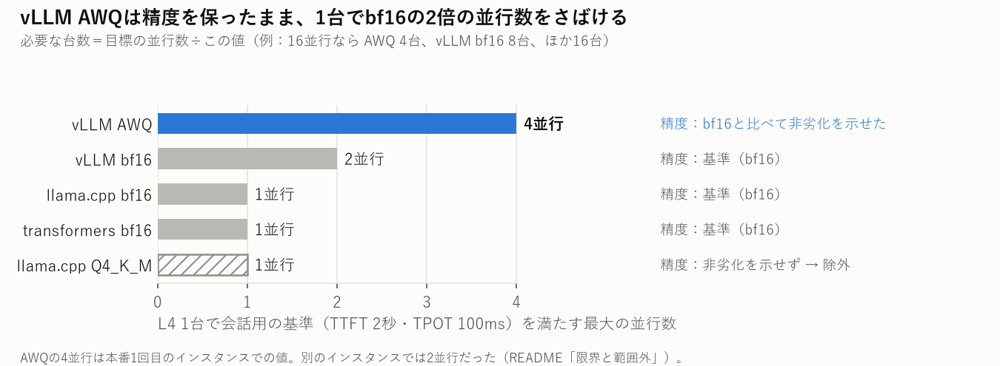
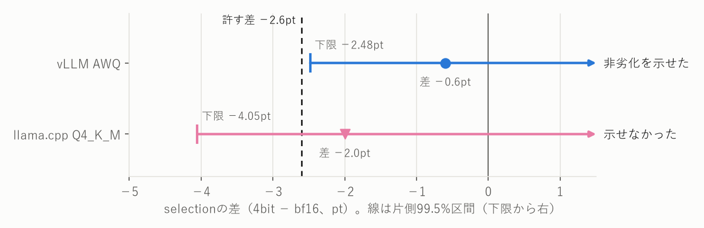
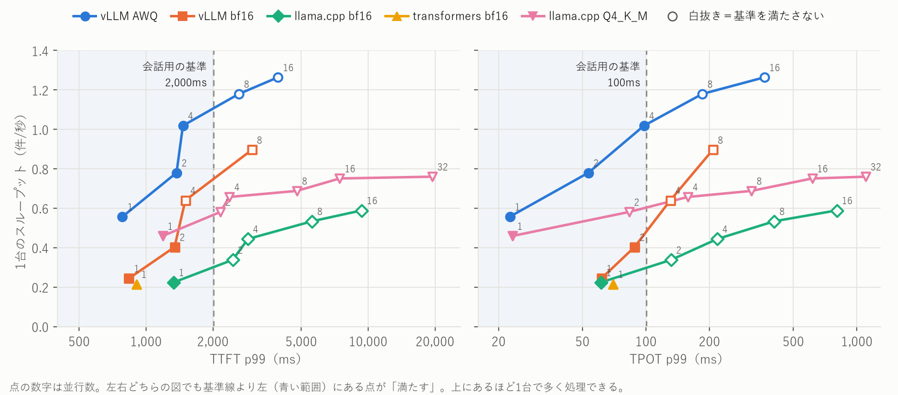
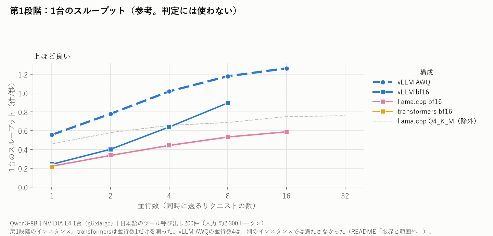

# 詳しい結果と経緯

READMEに載せない値・第1段階の結論・費用の内訳を置く。判定の規則と限界は[README](../README.md)にある。

- [第1段階](#第1段階目標の並行数が4以上なら-vllm-awq-が最も少ない台数だった)
- [詳しい値](#詳しい値)
- [評価セットと採点](#評価セットと採点)
- [費用の内訳](#費用の内訳)

---

## 第1段階：目標の並行数が4以上なら vLLM AWQ が最も少ない台数だった

**系統の違う3エンジン（transformers・llama.cpp・vLLM）では、精度の足切りを通った vLLM AWQ が1台で並行数4まで満たし、並行数16の目標で4台（vLLM bf16は8台）になった。**

読み方は第2段階の図と同じ（上が足切りを通った構成、斜線が精度で外れた構成、右の列が目標16並行の台数）。

| 目標の並行数 | 1 | 2 | 4 | 8 | 16 | 32 |
| --- | --- | --- | --- | --- | --- | --- |
| vLLM AWQ | 1 | 1 | **1** | **2** | **4** | **8** |
| vLLM bf16 | 1 | 1 | 2 | 4 | 8 | 16 |
| llama.cpp bf16・transformers bf16 | 1 | 2 | 4 | 8 | 16 | 32 |
| llama.cpp Q4_K_M（精度で除外） | 1 | 2 | 4 | 8 | 16 | 32 |
| 最も少ない構成 | 4構成が同じ | vLLMの2構成が同じ | vLLM AWQ | vLLM AWQ | vLLM AWQ | vLLM AWQ |

vLLM AWQの並行数4の判定は、インスタンスによって変わった（「[限界と範囲外](../README.md#限界と範囲外)」）。

### 4bitの非劣化は、各エンジンの中で自分のbf16と比べた

図は、臨床試験の報告指針CONSORTの非劣化・同等性試験の拡張が勧める形（区間と許す差を並べる）にならった。区間の左端が網掛けに入らなければ「非劣化を示せた」。

| 構成 | selection（bf16 → 4bit） | 差 | 片側99.5%の下限 | 判定 |
| --- | --- | --- | --- | --- |
| vLLM AWQ | 0.934 → 0.928 | −0.6pt | −2.48pt | **非劣化を示せた** |
| llama.cpp Q4_K_M | 0.935 → 0.915 | −2.0pt | −4.05pt | 示せなかった |

### 1台で基準を満たす並行数は、vLLM AWQ が4で最も大きかった

読み方は第2段階の図と同じ。横軸を並行数にそろえる形は、Red Hatの「Ollama vs. vLLM」のベンチマーク記事にならった。線が途中で切れているのは、その先の並行数に対応していなかった構成。

| 構成 | 最大の並行数 | 次の並行数での超過 |
| --- | --- | --- |
| vLLM AWQ | **4** | 並行数8で802/1,000 |
| vLLM bf16 | 2 | 並行数4で625/1,000 |
| llama.cpp bf16 | 1 | 並行数2で187/1,000 |
| transformers bf16 | 1 | 並行数2以上は測っていない |
| llama.cpp Q4_K_M | 1 | 並行数2で27/1,000 |

より厳しいinteractiveの基準（TTFT 500ms・TPOT 30ms）は、どの構成も並行数1で満たさなかった。

---

### 並行数16で、greedyの答えが変わらないとは言えなかった

**同じ構成の並行数1と16で正誤が入れ替わったのは1,000組中1〜2組だったが、2.6%未満と言い切る件数が無かった。**

| 構成 | 入れ替わり（1,000組中） | selectionの差 | 片側97.5%上限 | 判定 |
| --- | --- | --- | --- | --- |
| vLLM AWQ | 2 | +0.2pt | 3.57% | 等価とは示せなかった |
| vLLM bf16 | — | — | — | 並行数16に対応できなかった |
| llama.cpp bf16 | 1 | −0.1pt | 2.75% | 等価とは示せなかった |
| transformers bf16 | — | — | — | 測っていない（並行数1だけを測る構成） |
| llama.cpp Q4_K_M | — | — | — | 測っていない（量子化の構成は非劣化だけを測った） |

「変わる」と示したわけではない。判定は入れ替わった割合の片側97.5%上限（Clopper-Pearson）で行う（[ADR-0002](adr/0002-equivalence-margin.md)の追記2026-10-22・2026-10-26）。
第2段階ではこの確かめを回していない（選定の規則に入っていないため。ADR-0009の3）。

---

### 考察：llama.cpp Q4_K_Mで並行数が増えなかったのは、プリフィルが遅いから

**4bitで1トークンの生成は両エンジンとも2.7倍速くなったが、プロンプトの処理（プリフィル）はほとんど速くならず、llama.cppではプリフィルが先に基準に届いた。**

| | vLLM bf16 → AWQ | llama.cpp bf16 → Q4_K_M |
| --- | --- | --- |
| 1トークンの生成（並行数1のTPOT p50） | 61.4 → 22.4ms（2.7倍速い） | 60.9 → 22.5ms（2.7倍速い） |
| プロンプト約2,300トークンの処理（並行数1のTTFT p50） | 749 → 682ms（9%短い） | 1,209 → 1,073ms（11%短い） |
| 並行数2で基準を超えたリクエスト（TTFT超過／TPOT超過） | 0／3 → 0／0 | 38／153 → 26／1 |

- **生成**は重みをメモリから読み出す速さで決まり、4bitで重みが小さくなったぶん両エンジンとも速くなった。**プリフィル**は計算で決まる部分が大きく、llama.cppは4bitでもvLLMの約1.6倍の時間がかかる（1,073ms と 682ms）。
- llama.cpp Q4_K_Mの並行数2でTTFTが2秒を超えた26件は、**すべて**もう1件のプリフィルと時間が重なっていた（計測区間の全体では1,000件中36件だけが重なっていた）。重なるとサーバー側のプリフィルが約0.9秒から約1.5秒に延びた。
- 確かめ方：llama-serverのログ（リクエストごとの処理開始の時刻とプリフィルの時間）を、クライアントの記録と送った順に1件ずつ対応させた（1,202組中1,180組でプロンプトの長さが一致）。集計は [scripts/prefill_overlap.py](../scripts/prefill_overlap.py)。GPUのプロファイラーは使っていない。vLLMのログにはリクエストごとのプリフィルの時間が無いので、同じ方法では確かめていない。

### 第1段階の対象ごとの条件

第1段階（[ADR-0008](adr/0008-quantization-noninferiority.md)）：

| 条件 | transformers | llama.cpp | vLLM |
| --- | --- | --- | --- |
| 版 | 5.17.0 | `848bbda` | 0.31.0 |
| bf16 | `Qwen/Qwen3-8B` | 同じ重みから変換したGGUF | `Qwen/Qwen3-8B` |
| 4bit | 測らない | Q4_K_M（bf16 GGUFから固定した版の`llama-quantize`で作った） | AWQ（`Qwen/Qwen3-8B-AWQ`） |
| 並行数 | 1だけ（素の`generate()`にはリクエストをまとめる仕組みが無い） | 1〜32 | 1〜32 |

---

## 詳しい値

### 第2段階

各セル1,000件。数字は会話用の基準の超過件数。値は[第2段階の記録](gpu-main-batching-2026-10-30.md)（P99・スループット・回した後の確かめを含む）。

| 構成 | 並行数1 | 2 | 4 | 8 | 16 |
| --- | --- | --- | --- | --- | --- |
| TRT-LLM FP8 | 0 満たす | 0 満たす | 0 満たす | 545 | 968 |
| TRT-LLM AWQ | 0 満たす | 0 満たす | 21 | 838 | 968 |
| TRT-LLM bf16 | 0 満たす | 9 判定不能 | 725 | 946 | 対応していない |
| vLLM FP8 | 0 満たす | 1 満たす | 328 | 906 | 997 |
| vLLM AWQ | 0 満たす | 0 満たす | 24 | 840 | 985 |
| vLLM bf16 | 0 満たす | 1 満たす | 652 | 949 | 対応していない |
| SGLang FP8 | 0 満たす | 0 満たす | 35 | 858 | 974 |
| SGLang AWQ | 0 満たす | 0 満たす | 105 | 887 | 995 |
| SGLang bf16 | 0 満たす | 15 判定不能 | 809 | 953 | 対応していない |

印の無い値はすべて「満たさない」。5つの区間のスループットの差が10%を超えた（安定の印）4セルは、どれも超過0件の「満たす」で、値はそのまま使った。
普通の精度（temperature 0.7、selection）：SGLang bf16 0.929、TRT-LLM bf16 0.934（判定には使わない）。

### 第1段階：精度

並行数1、200件×5試行（本番2回目）、temperature 0.7の普通の精度の測定。判定には使わない（量子化の判定はgreedyで測った、上の非劣化の表）。CIはケース単位のブートストラップ95%。CIはすべて重なっていて、構成の優劣は結論にしない。

| 構成 | selection（95% CI） | arg_exact |
| --- | --- | --- |
| vLLM bf16 | 0.937 [0.912, 0.961] | 0.985 |
| llama.cpp bf16 | 0.939 [0.914, 0.963] | 0.987 |
| transformers bf16 | 0.935 [0.911, 0.959] | 0.984 |
| vLLM AWQ | 0.930 [0.902, 0.957] | 0.981 |
| llama.cpp Q4_K_M | 測っていない（量子化はgreedyの非劣化で判定した） | — |

### 第1段階：レイテンシ

各セル1,000件（ウォームアップを除く）。超過は、会話用の基準（TTFT 2,000ms・TPOT 100ms）のどちらかを超えたリクエストの数。
llama.cpp Q4_K_Mと最後の行は本番3回目、それ以外は本番1回目のインスタンスで測った。

| 構成 | 並行数 | TTFT p50 / p99（ms） | TPOT p50 / p99（ms） | 超過 | 判定 |
| --- | --- | --- | --- | --- | --- |
| vLLM AWQ | 1 | 682 / 783 | 22.4 / 22.6 | 0 | 満たす |
| | 2 | 717 / 1,372 | 38.6 / 53.3 | 0 | 満たす |
| | 4 | 736 / 1,466 | 70.2 / 97.9 | 2 | 満たす |
| | 8 | 817 / 2,619 | 126.0 / 185.1 | 802 | 満たさない |
| | 16 | 1,450 / 3,923 | 234.1 / 364.1 | 992 | 満たさない |
| | 32 | — | — | — | 対応していない（事前の判定） |
| vLLM bf16 | 1 | 749 / 838 | 61.4 / 61.5 | 0 | 満たす |
| | 2 | 825 / 1,344 | 78.8 / 88.2 | 3 | 満たす |
| | 4 | 849 / 1,503 | 105.4 / 130.4 | 625 | 満たさない |
| | 8 | 934 / 2,995 | 157.8 / 207.3 | 943 | 満たさない |
| | 16 | — | — | — | 対応していない（事前の判定） |
| llama.cpp bf16 | 1 | 1,209 / 1,333 | 60.9 / 61.2 | 0 | 満たす |
| | 2 | 1,390 / 2,455 | 92.8 / 131.5 | 187 | 満たさない |
| | 4 | 1,565 / 2,876 | 156.0 / 217.8 | 924 | 満たさない |
| | 8 | 1,696 / 5,597 | 283.6 / 406.3 | 986 | 満たさない |
| | 16 | 2,907 / 9,357 | 548.4 / 803.4 | 999 | 満たさない |
| | 32 | — | — | — | サーバーが起動しなかった |
| transformers bf16 | 1 | 808 / 904 | 69.4 / 69.8 | 0 | 満たす |
| llama.cpp Q4_K_M | 1 | 1,073 / 1,187 | 22.5 / 23.2 | 0 | 満たす |
| | 2 | 1,137 / 2,162 | 50.9 / 83.1 | 27 | 満たさない |
| | 4 | 1,215 / 2,370 | 109.3 / 157.6 | 769 | 満たさない |
| | 8 | 1,350 / 4,780 | 218.6 / 316.7 | 963 | 満たさない |
| | 16 | 2,345 / 7,440 | 425.0 / 613.7 | 999 | 満たさない |
| | 32 | 3,544 / 19,436 | 889.8 / 1,098.5 | 1,000 | 満たさない |
| vLLM AWQ（本番3回目） | 4 | 819 / 1,690 | 76.5 / 108.1 | 59 | 満たさない |

1件120秒の上限を超えたリクエストは超過として数えた：llama.cpp bf16の並行数8で5件・16で19件、Q4_K_Mの並行数16で4件・32で43件。

---

## 評価セットと採点

### 分離採点

ツール呼び出しの能力を1つの成功率にまとめず、質の違う3つを別々に測る。

| 指標 | 測るもの |
| --- | --- |
| selection | 正しいツールを選べるか（呼ぶべきでない場面で呼ばない、も含む） |
| arg_exact | enum・数値・日付など、完全一致で判定すべき引数を埋められるか |
| arg_semantic | 自由文の引数を、表記揺れを許して意味的に埋められるか |

`e2e`（全部正解）は派生指標として足すだけで、一次指標にはしない。ツールの選択を外した事例では引数の指標をN/Aにし、選択の失敗で引数を取り出す能力まで巻き添えにしない。

### ツールの数と紛らわしさ

ツール選択の正確さは、提示するツールの数と紛らわしさに強く左右される。3個から選ぶときの「選択95%」と、似た機能のツールが並ぶ40個から選ぶときの「選択95%」は別物である。

- ツールは汎用ERPの標準モジュール（マスタ・販売・購買・在庫・会計・人事・帳票）の40個。各モジュールに、機能の近いツール（検索・明細取得・集計・推移・未処理一覧）を意図的に置く。拡張カタログ（`schema/tools_extended.json`）は100個まで。
- 提示するツールの数（`tool_stage`）は実験の変数にできる。正解のツール、事例が宣言した紛らわしいツール、同じモジュールの近いツール、ほかのモジュールのツールの順で埋め、固定シードで並べ替える。宣言した紛らわしいツールが入りきらない場合は、黙って落とさずエラーにする。エンジンの比較は`tool_stage=10`で行う。
- 40個を全部渡すとプロンプトは約8,000トークン（10個の約3.5倍）になり、紛らわしいツールが並ぶほど選択の精度も落ちるので、クエリごとに10個に絞って渡す構成（Tool RAG）を想定する（[ADR-0003](adr/0003-latency-pass-verdict.md)の追記2026-10-24）。
- 同じ事例で、提示するツールの構成は固定したまま並び順だけを変えて5試行する（`eval_bench/repetition.py`）。並び順の運を平均で消し、5回とも同じ答えだったかを**consistency**として数える。

### 200件の作り方

日本語のツール呼び出しの評価セットには、Nejumi LLMリーダーボードのBFCL日本語版があるが、英語の汎用APIを翻訳したもので、単発のカテゴリは各30件しかない。
日本語の業務領域で、提示するツールの数を変えて測れる評価セットは見当たらなかったので自作した。

| provenance | 件数 | 作り方 |
| --- | --- | --- |
| `generated` | 186 | **正解をスクリプトが規則と固定シードで作り**、LLMはクエリ文だけを書く。正解を見せない別のモデルの検査と、全件の人の確認を通した。人が直した件は`generation.human_edit`に残す（[ADR-0004](adr/0004-expand-case-set.md)） |
| `seed_manual` | 5 | 手で書いた |
| `adversarial_manual` | 5 | 紛らわしさを狙って手で書いた |
| `grounded` | 4 | 公開文書（有価証券報告書・自治体の例規集）の種類と年度を引数の正解にする（`source`必須）。LLMはクエリ文の言い換えだけを担う |

どの作り方の事例を除いても数値を計算し直せる。クエリの言い換えに使ったモデルは、評価の対象から外す。negativeは30件。
件数は、負荷の下の精度で±2.6ptの等価性を言うのに要る約140件を超えるように決めた。

---

## 費用の内訳

GPUでの実行は9回のapplyに分けた（手順は[docs/gpu-runbook.md](gpu-runbook.md)）。費用はCost Explorerの値（第1段階の本番3回目は単価からの見積もり、第2段階は2026-10-30時点の見込み値）。

| apply | 内容 | インスタンスの時間 | 費用 |
| --- | --- | --- | --- |
| 2026-10-18 | 第1段階：疎通 | 2.0時間 | $2.4 |
| 2026-10-21 | 容量の疎通（途中で止めた） | 0.8時間 | $1.0 |
| 2026-10-22 | パイロット1 | 5.8時間 | $6.8 |
| 2026-10-24 | パイロット2 | 2.6時間 | $3.1 |
| 2026-10-24〜25 | 本番1回目：レイテンシ（18セル） | 12.7時間 | $15.1 |
| 2026-10-25 | 本番2回目：精度と負荷の下の精度（9セル） | 7.9時間 | $9.3 |
| 2026-10-26 | 本番3回目：量子化の非劣化とQ4_K_M（11セル） | 8.3時間 | 約$9.7 |
| 2026-10-27〜28 | 第2段階：疎通（39セル、3回に分けて流した） | 8.1時間 | 約$9.7 |
| 2026-10-28〜29 | 第2段階：本番（56セル） | 37.4時間 | 約$44.6 |
| 計 | | 約86時間 | 約$102 |

g6.xlargeは東京では1aと1cにしか無く、本番3回目は両方で約1.5時間 `InsufficientInstanceCapacity` が続いた。
